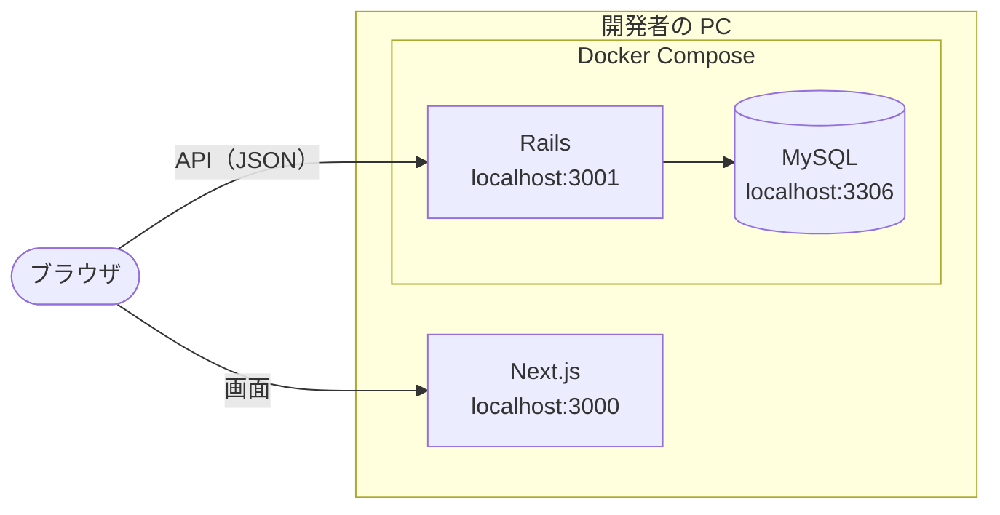
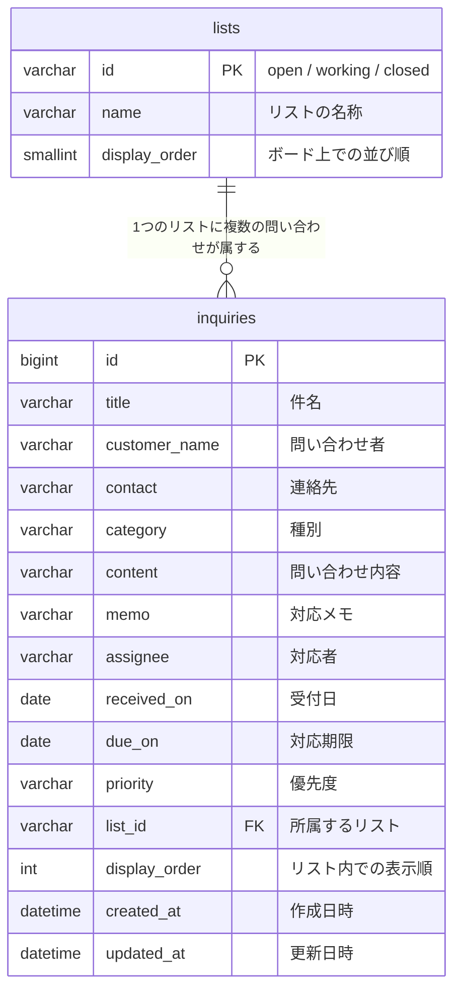
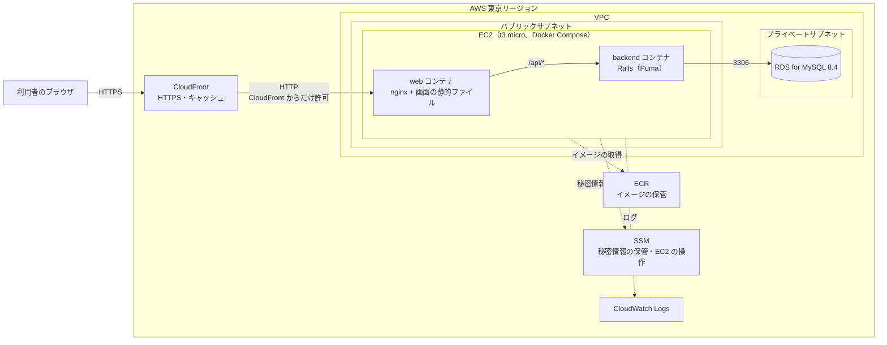

# 問い合わせ管理アプリ

## 概要

カンバンボード方式の問い合わせ管理アプリです。問い合わせを登録し、「未対応」「対応中」「完了」の 3 つのリストの間でカードを動かして、対応状況をチームで共有します。

対応者が決まっていない問い合わせや、対応期限を過ぎた問い合わせがボード上で目立つため、対応漏れにすぐ気づけます。

**[▶ アプリ操作動画を開く（MP4）](docs/アプリ操作動画.mp4)**

## 起動手順

必要なもの：[Docker Desktop](https://www.docker.com/products/docker-desktop/)、[Node.js 24](https://nodejs.org/)。Ruby と MySQL は PC に入れず、Docker のコンテナで動かします。

コマンドは Git Bash で、リポジトリのルートから実行します。

```bash
# 1. データベース（MySQL）とバックエンド（Rails）を起動する
docker compose up -d

# 2. テーブルを作り、リストとサンプルデータを入れる（初回だけ）
docker compose exec backend bin/rails db:prepare

# 3. フロントエンド（Next.js）を起動する
cd frontend
npm install   # 初回と、package.json が変わったときだけ
npm run dev
```

起動したら、ブラウザで次の URL を開きます。

| URL | 内容 |
| --- | --- |
| http://localhost:3000 | アプリの画面 |
| http://localhost:3001/up | バックエンドの死活確認（200 なら起動している） |

止めるときは、`npm run dev` のターミナルで `Ctrl + C` を押し、リポジトリのルートで `docker compose stop` を実行します。データは残ります。

ポートは Next.js が 3000、Rails が 3001、MySQL が 3306 に固定です。使用中でも別のポートでは起動せず、使っているプロセスを止めてから起動し直してください。

## 使い方

操作の結果はその都度データベースに保存されます。ほかのメンバーの操作は、画面を再読み込みすると反映されます。

### 問い合わせを登録する

1. 「未対応」リストの下にある「＋ 問い合わせを登録」を押します。
2. 件名・問い合わせ者・問い合わせ内容（必須）を入力し、種別と優先度を選びます。
3. 「登録」を押します。入力欄は空に戻るので、続けて次の問い合わせを登録できます。
4. 終わったら「キャンセル」または `Esc` キーで入力欄を閉じます。

### ステータスを変える・並べ替える

- カードをドラッグして別のリストへドロップすると、ステータスが変わります。「完了」から戻すこともできます。
- 同じリストの中でドラッグすると、表示順を自由に入れ替えられます。
- ボードの上にある「優先度順に並べ替え」を押すと、すべてのリストがそれぞれ優先度順に並びます。確認は表示されません。

### 詳細を確認・編集する

1. カードをクリックすると、問い合わせ詳細が開きます。
2. 項目を書き換えます。**保存ボタンはなく、項目ごとに自動で保存されます。** 1 行の入力欄は `Enter` キーか入力欄の外をクリックしたとき、複数行の入力欄は入力欄の外をクリックしたとき、選択肢と日付は選んだときに保存されます。
3. 「閉じる」、背景のクリック、`Esc` キーのいずれかで詳細を閉じます。

対応者・対応期限・連絡先・対応メモは、登録後にこの画面で設定します。

### 問い合わせを削除する

問い合わせ詳細の下にある「問い合わせを削除」を押し、確認ダイアログで「OK」を押します。削除した問い合わせは元に戻せません。

## 機能

| ID | 機能 | 内容 |
| --- | --- | --- |
| FR-01 | 問い合わせ登録 | 「未対応」リストに登録する。受付日は自動で設定される |
| FR-02 | 問い合わせ編集 | 件名・問い合わせ者・連絡先・種別・問い合わせ内容・対応メモを変更する |
| FR-03 | 問い合わせ削除 | 確認ダイアログを経て削除する |
| FR-04 | ステータス変更 | ドラッグ&ドロップ、または問い合わせ詳細で変更する |
| FR-05 | 問い合わせの並べ替え | 同じリストの中で、ドラッグして表示順を入れ替える |
| FR-06 | 対応者の設定 | 担当者を 1 人設定する。未割当のカードには「未割当」を赤字で表示する |
| FR-07 | 対応期限の設定 | 対応期限を設定する。期限を過ぎた未完了の問い合わせを目立たせる |
| FR-08 | 優先度の設定 | 高・中・低の 3 段階で設定し、カードに色付きで表示する |
| FR-09 | データ保存 | 操作の結果をデータベースに保存し、別の端末やほかのメンバーとも同じ内容を見られる |
| FR-10 | 全リストの優先度順並べ替え | ボタン 1 つで、すべてのリストをそれぞれ優先度順に並べ直す |

優先度順は、高 → 中 → 低の順です。同じ優先度の中は対応期限の近い順に並び、期限が未設定のものは後ろになります。問い合わせの登録後と優先度の変更後は、そのリストが自動でこの順に並び直ります。

ログインの機能はありません。詳しい仕様は[機能要件書](docs/functional-requirements.md)と[画面要件書](docs/screen-requirements.md)を参照してください。

## 技術構成

| 層 | 技術 | ディレクトリ |
| --- | --- | --- |
| フロントエンド | Next.js 16（App Router、静的書き出し）/ React 19 / TypeScript / CSS Modules / @hello-pangea/dnd | [frontend/](frontend/) |
| バックエンド | Ruby 4.0 / Ruby on Rails 8.1（API モード）/ Puma | [backend/](backend/) |
| データベース | MySQL 8.4 | [compose.yaml](compose.yaml)（ローカル） |
| テスト・検査 | フロントエンド：Vitest / React Testing Library / ESLint / Prettier<br>バックエンド：Minitest / RuboCop / Brakeman / bundler-audit | — |
| インフラ | AWS（CloudFront + EC2 + RDS）/ Terraform / Docker | [infra/](infra/) |

### ローカル環境の構成



ブラウザが画面を Next.js から受け取り、データは Rails の REST API から取得します。

### API

| メソッド | パス | 内容 |
| --- | --- | --- |
| GET | `/api/lists` | リストの一覧 |
| GET | `/api/inquiries` | 問い合わせの一覧 |
| POST | `/api/inquiries` | 問い合わせの登録 |
| GET | `/api/inquiries/:id` | 問い合わせ 1 件の取得 |
| PATCH | `/api/inquiries/:id` | 問い合わせの編集 |
| DELETE | `/api/inquiries/:id` | 問い合わせの削除 |
| PUT | `/api/inquiries/:id/position` | リストの移動・表示順の変更 |
| POST | `/api/inquiries/sort` | 全リストの優先度順並べ替え |

### データ構造



### リポジトリ構成

```text
InquiryManagement/
├── docs/             要件定義書・設計書・アプリ操作動画
├── mock/             画面モック
├── backend/          Ruby on Rails アプリケーション（API モード）
├── frontend/         Next.js アプリケーション
├── infra/            AWS の構成（Terraform）とデプロイ用スクリプト
├── Operation Check/  初級課題の動作確認動画
├── CLAUDE.md         Claude Code が従うルール
└── compose.yaml      ローカル開発用（Rails と MySQL）
```

開発コマンドは [backend/README.md](backend/README.md)・[frontend/README.md](frontend/README.md) を参照してください。

## インフラ

本番環境は AWS の東京リージョンに、Terraform で構築します。



| サービス | 役割 |
| --- | --- |
| CloudFront | 入口。HTTPS で通信し、画面の静的ファイルをキャッシュする |
| EC2 | nginx と Rails を Docker Compose で動かすサーバー 1 台 |
| RDS for MySQL | データベース |
| ECR | Docker イメージの保管 |
| SSM | 秘密情報の保管（パラメータストア）と、EC2 の操作（Session Manager・Run Command） |
| CloudWatch Logs | コンテナのログの保管 |

- 画面と API を同じドメインで配信します。nginx が画面の静的ファイルを返し、`/api/*` だけを Rails へ転送します。
- 利用者が入れる入口は CloudFront だけです。EC2 への直接のアクセスは、セキュリティグループと秘密のヘッダーの 2 段で拒否し、RDS は EC2 からの接続だけを受け付けます。
- ログインの機能もアクセス元の制限もないため、本番環境に実在する人の個人情報は入れません。

### 費用と休止

稼働中は約 0.05 ドル / 時間（月に約 38 ドル）かかります。費用を抑えるため、使わない期間はすべてのリソースを撤去して休止し、使うときに作り直して再開します。

登録した問い合わせは、休止の直前に取る DB のスナップショットで次の再開に引き継ぎます。再開すると URL は新しくなります。

### 操作コマンド

AWS CLI v2、Terraform、Docker Desktop、Node.js が必要です。コマンドは Git Bash で、リポジトリのルートから実行します。初めて構築するときは、先に認証の確認と Terraform の state 用 S3 バケットの作成が必要です（[AWS デプロイ手順書](docs/aws-deployment-guide.md) 4.・5.）。

| やりたいこと | コマンド |
| --- | --- |
| 初回の構築・再開 | `bash infra/scripts/startup.sh` |
| 休止 | `bash infra/scripts/shutdown.sh` |
| バックエンドの更新 | `bash infra/scripts/deploy-backend.sh` |
| 画面の更新 | `bash infra/scripts/deploy-frontend.sh` |
| 稼働中か調べる | `terraform -chdir=infra/terraform state list`（何も出なければ休止中） |
| URL を調べる | `terraform -chdir=infra/terraform output -raw app_url` |

## 文書

| 文書 | 内容 |
| --- | --- |
| [要件定義書](docs/requirements.md) | 背景・目的、スコープ、非機能要件、決定事項、受け入れ基準 |
| [機能要件書](docs/functional-requirements.md) | 機能の一覧と詳細 |
| [画面要件書](docs/screen-requirements.md) | 画面の構成と遷移 |
| [データ要件書](docs/data-requirements.md) | データ項目の定義、ER 図、データフロー図 |
| [データ設計書](docs/data-design.md) | テーブル定義、制約、初期データ |
| [API 設計書](docs/api-design.md) | REST API の一覧と要求・応答の形式 |
| [フロントエンド設計書](docs/frontend-design.md) | コンポーネント構成、状態の持ち方、表示ルール |
| [技術スタック](docs/tech-stack.md) | 各層の技術の選定と理由 |
| [インフラ設計書](docs/infra-design.md) | AWS の構成、ネットワーク、秘密情報、費用 |
| [AWS デプロイ手順書](docs/aws-deployment-guide.md) | 構築・更新・休止・再開の手順 |
| [開発フロー](docs/development-workflow.md) | Issue・ブランチ・PR の運用ルール |
