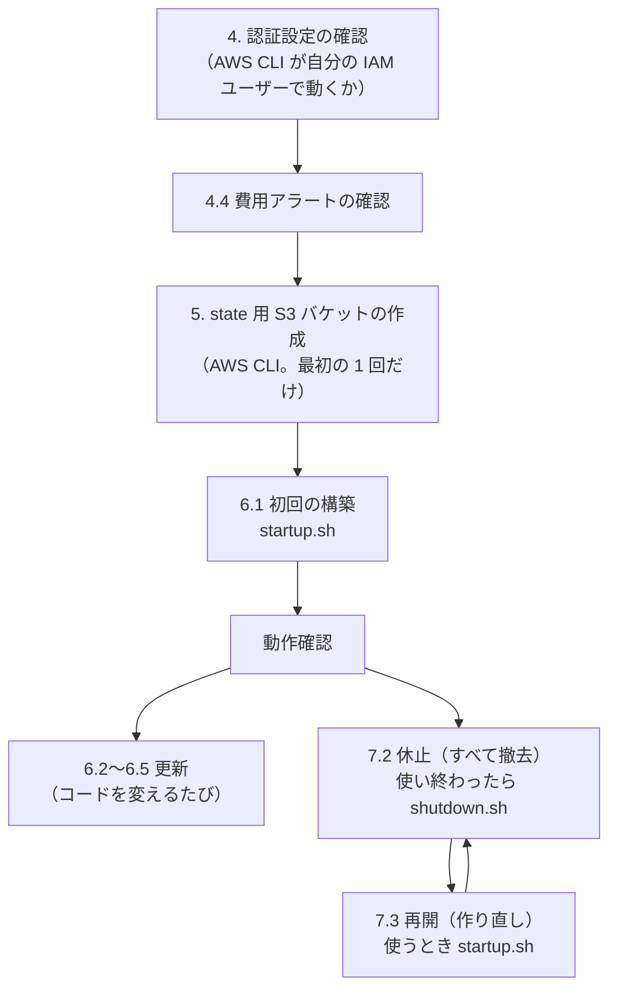

# 問い合わせ管理アプリ AWS デプロイ手順書

## 1. 文書情報

| 項目 | 内容 |
| --- | --- |
| 文書名 | 問い合わせ管理アプリ AWS デプロイ手順書 |
| 版数 | 1.0 |
| 作成日 | 2026-11-01 |
| 最終更新日 | 2026-11-01 |
| 作成者 | KeiT0773 |
| ステータス | 作成中（初回の構築で手順を確かめる） |
| 上位文書 | [インフラ設計書](infra-design.md) |
| 関連文書 | [技術スタック](tech-stack.md)、スキル `deploy-aws`（[.claude/skills/deploy-aws/SKILL.md](../.claude/skills/deploy-aws/SKILL.md)） |

本書は、[インフラ設計書](infra-design.md) の構成（CloudFront + EC2 + RDS for MySQL）を **実際に作り、更新し、休止・再開する手順** と、そのために必要な AWS・Terraform の基礎知識をまとめる。構成そのもの（なぜその形にしたか）はインフラ設計書を、Claude が守る約束はスキル `deploy-aws` を正とする。

タスク管理アプリの AWS デプロイ手順書と同じ構成で書き、EC2 の構成で変わった部分（イメージが 2 つになること、EC2 への反映を SSM Run Command で行うこと、EC2 の中の調べ方）を書き換えている。

### 1.1 変更履歴

| 版数 | 日付 | 変更内容 | 変更者 |
| --- | --- | --- | --- |
| 1.0 | 2026-11-01 | 初版作成。`infra/` の Terraform とスクリプトに合わせて、認証設定、state の置き場、構築・更新・休止・再開の手順、トラブルシューティングを定義 | KeiT0773 |

### 1.2 本書のコマンドについて

- コマンドはすべて **Git Bash** で、**リポジトリのルート**（`InquiryManagement/`）から実行する。
- 先頭の `$` は入力を表す記号で、入力しない。
- Git Bash は `/` で始まる引数を Windows のパスに書き換えることがある。CloudWatch Logs のロググループ名（`/inquirymanagement/...`）など、`/` で始まる値を渡す `aws` コマンドには、先頭に `MSYS_NO_PATHCONV=1` を付ける。
- `infra/scripts/` のスクリプトは、何を作る・消すかを表示してから `[y/N]` で確認を求める。`--yes` を付けると確認を省略する（内容を確認済みのときだけ使う）。

---

## 2. 基礎知識

### 2.1 IaC（Infrastructure as Code）とは

サーバーやネットワークを、コンソール（ブラウザの画面）で手作業で作るのではなく、**設定をコード（テキスト）として書き、そのコードから作る** 考え方。本プロジェクトでは Terraform を使う。

| 手作業で作る場合 | IaC（Terraform）で作る場合 |
| --- | --- |
| 何をどう設定したかが記録に残らない | コードが記録になり、Git で変更の履歴を追える |
| 作り直すと、設定の漏れや違いが出る | 同じコードから、何度でも同じ構成を作れる |
| 消すときに消し忘れが出る | `terraform destroy` で、作ったものをまとめて消せる |

本プロジェクトは「使わない期間はすべて消し、使うときに作り直す」（休止・再開。7.）ことで費用を抑える。これは IaC でなければ現実的でない。

### 2.2 Terraform の仕組み

#### 2.2.1 コードと実物の差分を埋める

Terraform のコード（`infra/terraform/*.tf`）には「あるべき姿」を書く。Terraform はコードと AWS の実物を比べ、**差分だけ** を作る・変える・消す。

| コマンド | すること | AWS の実物 |
| --- | --- | --- |
| `terraform init` | プロバイダー（AWS を操作するプラグイン）を取得し、state の保存先に接続する | 変えない |
| `terraform plan` | コードと実物を比べ、何を作る・変える・消すか（計画）を表示する | 変えない |
| `terraform apply` | 計画を実行する | **変える** |
| `terraform destroy` | 作ったものをすべて消す | **消す** |

計画の表示では、記号で操作の種類が分かる。

| 記号 | 意味 | 注意 |
| --- | --- | --- |
| `+` | 作る | — |
| `~` | その場で変える | — |
| `-` | 消す | データを持つもの（RDS）が含まれていないか必ず確かめる |
| `-/+` | 消してから作り直す | RDS なら **データが消える**。スクリプトは RDS の作り直しを常に中止する |

#### 2.2.2 変数と terraform.tfvars

環境によって変わる値（イメージのタグ、許可する IPv6 のネットワーク番号など）は、`variables.tf` で変数として宣言し、値を `terraform.tfvars` に書く。`terraform.tfvars` には自宅のネットワーク番号が入るため、Git には含めない（`infra/.gitignore`）。スクリプトが値を自動で書き換えるため、手で書く必要はない。

#### 2.2.3 state（作ったものの台帳）

Terraform は、自分が作ったリソースの一覧と属性を **state** というファイルに記録する。次の plan では、この台帳と実物を見比べて差分を出す。

- state は S3 バケットに置く（5.）。PC が壊れても台帳は失われない。
- state には DB のパスワードなど **秘密の値が平文で入る**。バケットはパブリックアクセス禁止・暗号化・バージョニングを必須にする（[インフラ設計書](infra-design.md) 9.・12.4）。
- 同じく、`terraform plan -out=tfplan` で保存した計画ファイルにも秘密の値が入る。`infra/.gitignore` で除外しており、スクリプトは使い終わった計画ファイルを消す。
- コンソールで手作業でリソースを消すと、台帳と実物が食い違う。消すときは必ずスクリプト（Terraform）で消す。

### 2.3 AWS の基礎（本構成で使うもの）

| 用語 | 意味 | 本構成での使い方 |
| --- | --- | --- |
| リージョン / AZ | AWS のデータセンターの地域 / その中の独立した建物群 | 東京（`ap-northeast-1`）。EC2 は `1a`、RDS のサブネットは `1a` と `1c` |
| VPC / サブネット | AWS の中に作る自分専用のネットワーク / その区画 | EC2 はパブリックサブネット、RDS はプライベートサブネット（外へ出る経路が無い） |
| セキュリティグループ | リソースごとのファイアウォール | EC2 は CloudFront からの 80 番だけ、RDS は EC2 からの 3306 番だけを受け付ける |
| EC2 | 仮想サーバー | `t3.micro` 1 台。Docker Compose で web（nginx + 画面）と backend（Rails）を動かす |
| RDS | AWS が運用するデータベース | MySQL 8.4、`db.t4g.micro` 1 台 |
| CloudFront | 世界中の拠点から配信する入口（CDN） | HTTPS の入口。CloudFront Functions で、自宅のネットワーク以外からの要求を 403 にする |
| ECR | Docker イメージの置き場所 | `inquirymanagement-backend`・`inquirymanagement-web` |
| SSM | サーバーの管理の仕組みの集まり | パラメータストア（秘密情報とイメージのタグ）、Session Manager（EC2 に入る）、Run Command（EC2 でコマンドを実行する） |
| IAM ロール | AWS のサービスが名乗る身分 | EC2 が ECR・SSM・CloudWatch Logs を使うための権限 |
| CloudWatch Logs | ログの保管場所 | `/inquirymanagement/web`・`/inquirymanagement/backend`（7 日保持） |

---

## 3. 全体の流れと事前準備

### 3.1 全体の流れ



### 3.2 必要なツール

| ツール | 確認コマンド | 確認済みのバージョン（2026-11-01） | 用途 |
| --- | --- | --- | --- |
| AWS CLI v2 | `aws --version` | 2.31.38 | AWS をコマンドで操作する |
| Terraform | `terraform -version` | 1.13.5（1.10 以上が必要） | インフラを構築する |
| Docker Desktop | `docker --version` | 29.8.0 | backend・web のイメージを作る。**起動しておく** |
| Node.js / npm | `node --version` | 24 系 | 画面をビルドする。IPv6 のネットワーク番号の計算にも使う |
| Git Bash | — | — | 本書のコマンドを実行する |

---

## 4. AWS アカウントとの認証設定

### 4.1 仕組み

AWS CLI と Terraform は、どちらも `~/.aws/credentials` の **IAM ユーザーのアクセスキー**（`default` プロファイル）で AWS を操作する。アクセスキーはパスワードと同じく秘密であり、コード・リポジトリ・チャット（AI との会話を含む）に出さない。`~/.aws/credentials` の中身を表示するコマンドを AI に実行させない。

### 4.2 登録済みの設定を確認する

```bash
$ aws configure list            # TYPE が shared-credentials-file、region が ap-northeast-1 であること
$ aws sts get-caller-identity   # 誰として操作するか
```

`Arn` が `...:user/<名前>`（IAM ユーザー）であることを確かめる。`...:root` ならルートユーザーのキーであり、使うのをやめて IAM ユーザーを作り直す（タスク管理アプリの手順書 4.3）。

> **本プロジェクトの確認結果（2026-11-01）**
> IAM ユーザー `taka-admin`（アカウント `512795167785`）。タスク管理アプリと同じ認証設定をそのまま使う。

### 4.3 アクセスキーを安全に扱う

タスク管理アプリの手順書 4.4 と同じ（キーは 1 本だけ有効にする、定期的に作り直す、漏れたかもしれないときはすぐ無効にする）。

### 4.4 費用アラート（AWS Budgets）

同じアカウントに、アカウント全体を対象にした予算 `aws-study-Spend Budget`（月 1 ドル）が既にある。本アプリの費用もこの予算に含まれて通知されるため、**本アプリ用の予算は別に作らない**（[インフラ設計書](infra-design.md) 11.3・14. の決定）。

- 予算が月 1 ドルのため、本アプリを数時間動かしただけで通知が届く。通知が届いたら、休止し忘れていないか（7.）を確かめる。
- 本アプリ用の予算を別に作るときは、タスク管理アプリの手順書 4.5 のコマンドで作る（予算の名前を `inquirymanagement-monthly` にする）。タグで絞った予算にするには、請求の設定でコスト配分タグ `Project` を有効にする必要がある。
- Budgets は費用の集計に数時間〜1 日の遅れがある。即時に止まる仕組みではなく、通知である。

確認するコマンド：

```bash
$ aws budgets describe-budgets --account-id "$(aws sts get-caller-identity --query Account --output text)" \
    --query 'Budgets[].[BudgetName,BudgetLimit.Amount]' --output table
```

---

## 5. Terraform の state 置き場を作る

2.2.3 の state を保存する S3 バケットを、**AWS CLI で** 作る。Terraform で作らないのは、「state を置く場所」を Terraform で管理すると、その state をどこに置くかという循環が起きるためである。この作業は **最初の 1 回だけ** 行う。休止（7.2）でも消さない。

```bash
# バケット名（S3 のバケット名は世界で一意なので、アカウント ID を付ける）
$ ACCOUNT_ID=$(aws sts get-caller-identity --query Account --output text)
$ STATE_BUCKET="inquirymanagement-tfstate-${ACCOUNT_ID}"
$ echo "$STATE_BUCKET"

# 1. バケットを作る（東京リージョンを明示する）
$ aws s3api create-bucket \
    --bucket "$STATE_BUCKET" \
    --region ap-northeast-1 \
    --create-bucket-configuration LocationConstraint=ap-northeast-1

# 2. バージョニングを有効にする（state を壊しても過去の版に戻せる）
$ aws s3api put-bucket-versioning \
    --bucket "$STATE_BUCKET" \
    --versioning-configuration Status=Enabled

# 3. 保存時の暗号化を有効にする（state には DB パスワードが入るため）
$ aws s3api put-bucket-encryption \
    --bucket "$STATE_BUCKET" \
    --server-side-encryption-configuration '{"Rules":[{"ApplyServerSideEncryptionByDefault":{"SSEAlgorithm":"AES256"}}]}'

# 4. パブリックアクセスをすべて禁止する
$ aws s3api put-public-access-block \
    --bucket "$STATE_BUCKET" \
    --public-access-block-configuration BlockPublicAcls=true,IgnorePublicAcls=true,BlockPublicPolicy=true,RestrictPublicBuckets=true

# 確認
$ aws s3api get-bucket-versioning --bucket "$STATE_BUCKET"
$ aws s3api get-public-access-block --bucket "$STATE_BUCKET"
```

スクリプトは、Terraform がまだこのバケットに接続していなければ、自動で `terraform init` を実行する。バケットが無ければ、5. を行うよう表示して止まる。

---

## 6. デプロイ

### 6.1 初回の構築

初回の構築は、再開（7.3）と同じ `startup.sh` で行う。スナップショットが無いため、DB は新しく作られ、問い合わせは空から始まる（3 つのリストは自動で入る）。

**前提**：main を最新にし、コミットしていない変更が無いこと（イメージのタグにコミットのハッシュを使うため）。Docker Desktop が起動していること。自宅の IPv6 のネットワークにつながっていること。

```bash
$ git switch main && git pull --ff-only
$ bash infra/scripts/startup.sh
```

スクリプトは次の順に進む。

| 段 | すること | かかる時間 |
| --- | --- | --- |
| 1 | AWS の認証と、state の保存先への接続を確かめる | 数秒 |
| 2 | 復元するスナップショットを探す（初回は無いので DB を新規作成） | 数秒 |
| 3 | この PC の IPv6 アドレスから、自宅のネットワーク番号（先頭 64 ビット）を調べて許可リストに書く | 数秒 |
| 4 | 作られるリソースの件数を表示して、`[y/N]` で確認を求める | — |
| 5 | ECR（イメージの置き場所）だけを先に作る | 数秒 |
| 6 | backend（Rails）と web（画面をビルドして nginx に入れたもの）のイメージを作って ECR に登録する | 5〜10 分 |
| 7 | 残りすべてを作る（VPC、RDS、EC2、CloudFront など）。EC2 は起動時に Docker を入れ、コンテナを起動する。新しい DB には backend がテーブルを作る | 15〜25 分 |
| 8 | CloudFront の URL で、画面・`/api/lists` が 200 を返すこと、IPv4 からは 403 になることを確かめる | 数分 |

最後に表示される `URL: https://xxxx.cloudfront.net` をブラウザで開く。**URL は再開のたびに変わる。**

### 6.2 バックエンドを更新する

`backend/` を変えてコミットし、PR をマージしたあと、main で実行する。

```bash
$ git switch main && git pull --ff-only
$ bash infra/scripts/deploy-backend.sh
```

| 段 | すること |
| --- | --- |
| 1 | 今のコミットの backend イメージを作って ECR に登録し、`terraform.tfvars` の `backend_image_tag` を書き換える |
| 2 | `terraform plan` を表示する。**イメージのタグのパラメータ（`aws_ssm_parameter.image_tag`）が変わるだけ** であることを確かめ、`[y/N]` で確認を求める |
| 3 | apply したあと、SSM Run Command で EC2 の `start.sh` を実行する。新しいイメージを取得してコンテナを入れ替え、Rails の `/up` が 200 になるまで待つ。マイグレーションがあれば、起動時の `db:prepare` が適用する |
| 4 | CloudFront の URL で画面と API を確かめる |

入れ替えの間、数十秒ほど API が応答しないことがある（EC2 が 1 台のため）。

### 6.3 画面を更新する

`frontend/` を変えてコミットし、PR をマージしたあと、main で実行する。

```bash
$ bash infra/scripts/deploy-frontend.sh
```

6.2 と同じ流れで web イメージを入れ替え、最後に CloudFront のキャッシュを無効化する。画面の HTML は nginx が `Cache-Control: no-cache` を付けて返すため、無効化しなくても 1 秒ほどで新しい画面になるが、念のため無効化する。

### 6.4 インフラの構成を変更する

`infra/terraform/` を変えるときは、Issue → ブランチ → PR で直し、**マージしたあとの main で** 適用する（ブランチのコードで適用すると、AWS の実物が main より先に進んでしまう）。

```bash
$ terraform -chdir=infra/terraform plan    # 何が変わるかを確かめる
```

- 計画に RDS の `-/+`（作り直し）や `-`（削除）が含まれていたら、適用しない。データが消える。
- `user_data`（`templates/` の 3 つのファイルを含む）を変えると、EC2 が作り直しになる（`aws_instance.app must be replaced`）。EC2 は使い捨て（データは RDS）なので問題ない。CloudFront のオリジンも同時に更新され、URL は変わらない。
- 適用は、計画を確かめてから `terraform -chdir=infra/terraform apply` で行う。

### 6.5 自宅のネットワーク番号が変わったとき

自宅の IPv6 のネットワーク番号は、ルーターの再起動や回線の契約の変更で変わることがある。変わると、画面も API も 403（「このネットワークからはアクセスできません」）になる。

```bash
$ bash infra/scripts/update-allowed-ip.sh
```

今の PC の IPv6 アドレスから新しいネットワーク番号を調べ、CloudFront Functions の許可リストだけを書き換える。CloudFront の全拠点に反映されるまで数分かかる。休止中は不要（再開の `startup.sh` が自動で今の番号を使う）。

---

## 7. 費用・休止・再開

### 7.1 費用の目安

[インフラ設計書](infra-design.md) 11. の見積もり。

| 状態 | 1 時間あたり | 内訳 |
| --- | --- | --- |
| 稼働中 | 約 0.05 ドル | EC2・EBS・パブリック IPv4・RDS |
| 休止中 | ほぼ 0 ドル | DB のスナップショット（最新 2 つ）と state 用のバケットだけ |

1 日 8 時間 × 月 20 日だけ稼働させると、月 8 ドル前後になる。**使い終わったら必ず休止する。**

### 7.2 休止する

```bash
$ bash infra/scripts/shutdown.sh
```

| 段 | すること |
| --- | --- |
| 1 | `terraform plan -destroy` で撤去するものの件数を表示し、`[y/N]` で確認を求める |
| 2 | RDS のスナップショット（`inquirymanagement-YYYYMMDD-HHMM`）を取り、完成を待つ。**完成しなければ何も消さずに中止する** |
| 3 | 最新の 2 つより古いスナップショットを消す |
| 4 | すべて撤去する（CloudFront の削除に 15〜25 分かかる） |
| 5 | Terraform が管理するものが残っていないことを確かめ、残っているスナップショットを表示する |

撤去は取り消せない。登録した問い合わせは 2. のスナップショットに入り、次の再開で戻る。

### 7.3 再開する

```bash
$ bash infra/scripts/startup.sh
```

6.1 と同じ流れで、最新のスナップショットから DB を復元して作り直す。問い合わせは休止前の状態に戻る。**URL は新しくなる。** 秘密の値（DB のパスワードなど）も再開のたびに新しく作られる。

### 7.4 アプリの利用をやめる（すべて片付ける）

1. `shutdown.sh` で休止する。
2. 残ったスナップショットを消す（**問い合わせのデータが完全に消える**）。

   ```bash
   $ aws rds describe-db-snapshots --snapshot-type manual \
       --query "DBSnapshots[?starts_with(DBSnapshotIdentifier, 'inquirymanagement-')].DBSnapshotIdentifier"
   $ aws rds delete-db-snapshot --db-snapshot-identifier <スナップショット名>
   ```

3. state 用のバケットを消す（中身の版もすべて消す必要がある。コンソールの S3 の画面で「空にする」→「削除」が簡単）。

### 7.5 費用の実績を確認する

```bash
# 今月の費用（サービスごと）
$ aws ce get-cost-and-usage \
    --time-period Start=$(date +%Y-%m-01),End=$(date -d tomorrow +%Y-%m-%d) \
    --granularity MONTHLY --metrics UnblendedCost \
    --group-by Type=DIMENSION,Key=SERVICE \
    --query 'ResultsByTime[0].Groups[?Metrics.UnblendedCost.Amount>`0.001`].[Keys[0],Metrics.UnblendedCost.Amount]' \
    --output table
```

Cost Explorer の API は 1 回 0.01 ドルかかる。コンソールの「請求とコスト管理」の画面で見れば無料。

---

## 8. Claude にデプロイさせるときの約束

詳細はスキル `deploy-aws` にあり、Claude はそれに従う。利用者として知っておくことは次のとおり。

| 約束 | 内容 |
| --- | --- |
| 最初に誰として操作するかを確かめる | `aws sts get-caller-identity` の結果（アカウント `512795167785`）を報告する |
| 変える前に必ず承認を得る | スクリプトを `--yes` なしで実行して計画を示し、利用者が承認してから `--yes` を付けて実行する |
| 撤去は毎回承認を得る | 以前「休止して」と言っていても、撤去のたびに消えるものを示して確認する。`-auto-approve` は付けない |
| アクセスキーを読まない | `~/.aws/credentials` を開かない |
| 最後に状態を報告する | 稼働中か休止中か。稼働中なら費用がかかり続けていること |

Claude の環境には端末が無いため、`--yes` なしのスクリプトは確認の手前で止まる（「確認の入力ができないため、ここで止めました」）。これは想定どおりの動きである。

---

## 9. トラブルシューティング

### 9.1 コンテナが起動しない、すぐ止まる

**ログを見る**（CloudWatch Logs）

```bash
$ MSYS_NO_PATHCONV=1 aws logs tail /inquirymanagement/backend --since 30m
$ MSYS_NO_PATHCONV=1 aws logs tail /inquirymanagement/web --since 30m
$ MSYS_NO_PATHCONV=1 aws logs tail /inquirymanagement/backend --follow   # 流れてくるログを見続ける（Ctrl+C で終了）
```

**EC2 の中に入って調べる**（SSM Session Manager。SSH の鍵は不要）

Session Manager を AWS CLI から使うには、PC に「Session Manager プラグイン」を入れる（https://docs.aws.amazon.com/systems-manager/latest/userguide/session-manager-working-with-install-plugin.html）。入れない場合は、コンソールの EC2 の画面で、インスタンスを選んで「接続」→「セッションマネージャー」でブラウザから入れる。

```bash
$ aws ssm start-session --target "$(terraform -chdir=infra/terraform output -raw instance_id)"
```

EC2 の中では、次のコマンドで調べる（root で実行する）。

```bash
sudo -i
cd /opt/inquirymanagement
docker compose ps                         # コンテナの状態
docker compose logs --tail 100 backend    # Rails のログ
systemctl status inquirymanagement        # 起動時の start.sh の結果
tail -n 100 /var/log/cloud-init-output.log   # 初回起動時の設定（user_data）の結果
./start.sh                                # コンテナを入れ替え直す
```

| よくある原因 | 見分け方 | 対処 |
| --- | --- | --- |
| DB に接続できない | backend のログに `Can't connect to MySQL server` や `Access denied` | RDS の状態（`aws rds describe-db-instances --db-instance-identifier inquirymanagement --query 'DBInstances[0].DBInstanceStatus'`）が `available` か確かめる。復元直後はパスワードの変更に数分かかることがある。数分後に `./start.sh` |
| メモリ不足 | `docker compose ps` で backend が再起動を繰り返す。`dmesg` に `Out of memory` | スワップ（1 GB）が有効か `free -m` で確かめる |
| イメージが取得できない | `start.sh` の出力に `pull access denied` や `manifest unknown` | ECR にそのタグのイメージがあるか確かめる（`aws ecr describe-images --repository-name inquirymanagement-backend`） |

### 9.2 画面は出るが、API が 502 / 504 になる、または画面も出ない

| 症状 | 原因 | 対処 |
| --- | --- | --- |
| API だけ 502 | nginx から backend へ転送できない（backend が起動していない） | 9.1 で backend のログを見る |
| 画面も API も 502 / 504 | CloudFront から EC2 に届かない（EC2 の起動中、または web コンテナが止まっている） | 構築の直後なら数分待つ。続くなら 9.1 で `docker compose ps` を見る |
| 画面も API も 403（本文が「403 Forbidden」の nginx の画面） | nginx が確認用ヘッダー（`X-Origin-Verify`）を拒否している | 秘密の値と EC2 の `.env` が食い違っている。EC2 で `./start.sh` を実行し直す |

### 9.3 画面が古いまま、または真っ白

- ブラウザで強制再読み込み（Ctrl+Shift+R）する。
- `deploy-frontend.sh` の最後のキャッシュの無効化が終わっているか確かめる。
- 真っ白なら、ブラウザの開発者ツールの「コンソール」にエラーが出ていないか見る。

### 9.4 認証・権限のエラー

| エラー | 対処 |
| --- | --- |
| `Unable to locate credentials`、`InvalidClientTokenId` | 4.2 の確認をやり直す。キーが無効なら作り直す |
| `AccessDenied`（PC から） | IAM ユーザーの権限を確かめる（タスク管理アプリの手順書 4.2 (3)） |
| EC2 の中で `AccessDeniedException`（SSM・ECR・Logs） | インスタンスロール（`ec2.tf` の `aws_iam_role_policy.ec2_app`）の権限の範囲を確かめる |

### 9.5 Terraform のエラー

| エラー | 対処 |
| --- | --- |
| `Error acquiring the state lock` | 別のところで Terraform が動いている。終わるのを待つ。途中で強制終了した場合だけ、表示された ID で `terraform -chdir=infra/terraform force-unlock <ID>` |
| 撤去が途中で失敗した | 数分待ってから、もう一度 `shutdown.sh` を実行する（CloudFront の無効化が終わる前に消そうとした場合など） |
| `precondition` のエラー（許可リストが空、イメージのタグが空） | スクリプトを使わずに `terraform apply` した。スクリプトから実行する |
| `Backend initialization required` | `terraform -chdir=infra/terraform init -reconfigure -backend-config="bucket=inquirymanagement-tfstate-<アカウント ID>"` |

### 9.6 画面や API が 403「このネットワークからはアクセスできません」になる

CloudFront Functions が拒否している（[インフラ設計書](infra-design.md) 6.4）。

| 原因 | 対処 |
| --- | --- |
| 自宅の IPv6 のネットワーク番号が変わった | 6.5 の `update-allowed-ip.sh` |
| IPv4 で接続している（IPv6 が使えない回線・機器） | IPv4 はすべて拒否する設計。IPv6 で接続できる環境から使う |
| 自宅以外の場所から使っている | 利用できない（要件定義書 8.） |

今の PC の IPv6 アドレスは `curl -6 https://api6.ipify.org` で確かめられる。

---

## 10. コマンド早見表

| やりたいこと | コマンド |
| --- | --- |
| 初回の構築・再開 | `bash infra/scripts/startup.sh` |
| 休止 | `bash infra/scripts/shutdown.sh` |
| バックエンドの更新 | `bash infra/scripts/deploy-backend.sh` |
| 画面の更新 | `bash infra/scripts/deploy-frontend.sh` |
| 許可するネットワーク番号の更新 | `bash infra/scripts/update-allowed-ip.sh` |
| 稼働中か調べる | `terraform -chdir=infra/terraform state list`（何も出なければ休止中） |
| URL を調べる | `terraform -chdir=infra/terraform output -raw app_url` |
| ログを見る | `MSYS_NO_PATHCONV=1 aws logs tail /inquirymanagement/backend --since 30m` |
| EC2 に入る | `aws ssm start-session --target "$(terraform -chdir=infra/terraform output -raw instance_id)"` |
| スナップショットの一覧 | `aws rds describe-db-snapshots --snapshot-type manual --query "DBSnapshots[].DBSnapshotIdentifier"` |
