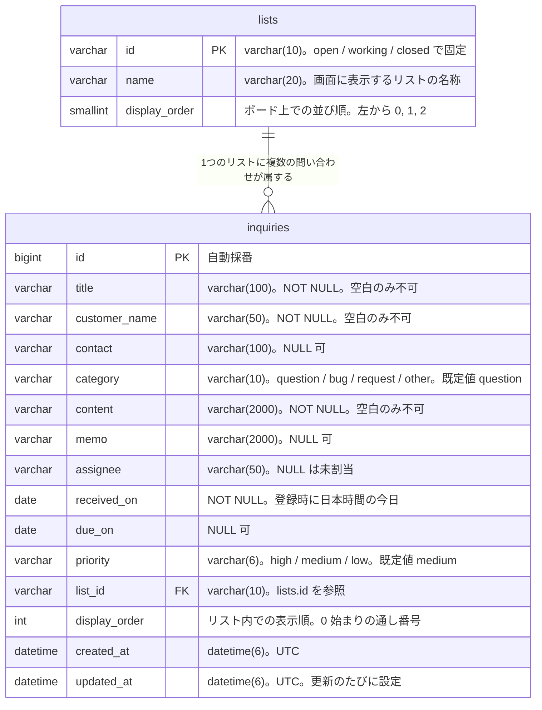

# 問い合わせ管理アプリ データ設計書

## 1. 文書情報

| 項目 | 内容 |
| --- | --- |
| 文書名 | 問い合わせ管理アプリ データ設計書 |
| 版数 | 1.3 |
| 作成日 | 2026-10-31 |
| 最終更新日 | 2026-10-31 |
| 作成者 | KeiT0773 |
| ステータス | 作成中（レビュー待ち） |
| 上位文書 | [データ要件書](data-requirements.md) |
| 関連文書 | [要件定義書](requirements.md)、[機能要件書](functional-requirements.md)、[画面要件書](screen-requirements.md)、[技術スタック](tech-stack.md) |
| 下位文書 | [API 設計書](api-design.md) |

本書は、[データ要件書](data-requirements.md) が「基本設計で決定する」として保留した **具体的な格納形式**（テーブル定義、データ型、桁数、制約、初期データ）と、それをデータベースへ反映する手順（マイグレーション方針）を定義する。

データベース製品は [技術スタック](tech-stack.md) 5. のとおり **MySQL 8.4 系** とし、本書の SQL はすべて MySQL の構文に従う。実際のテーブルは Rails のマイグレーション（10.）で作る。本書の SQL は、マイグレーションを適用した結果としてできあがるテーブルの形を示すものである。

本書が扱う範囲と、扱わない範囲は次のとおり。

| 範囲 | 扱い | 定義する文書 |
| --- | --- | --- |
| テーブル定義、制約、索引、初期データ、マイグレーション | 本書で定義する | 本書 |
| Rails のモデル（クラス名、validations、関連づけ） | 名前と対応だけを 9. に示す。詳細は実装で定める | ― |
| REST API の一覧、要求・応答の形式、同時に操作されたときの API の振る舞い | 本書では扱わない | [API 設計書](api-design.md) |

### 1.1 変更履歴

| 版数 | 日付 | 変更内容 | 変更者 |
| --- | --- | --- | --- |
| 1.0 | 2026-10-31 | 初版作成。データ要件書 1.0 版をもとに、テーブル定義・制約・初期データ・マイグレーション方針を確定 | KeiT0773 |
| 1.1 | 2026-10-31 | API 設計書の作成に伴い、下位文書と API 設計書への参照をリンクに変更 | KeiT0773 |
| 1.2 | 2026-10-31 | インフラ設計書の作成に伴い、10.1 の本番での適用のタイミングを確定し、12. 保留事項の 2 件を解消 | KeiT0773 |
| 1.3 | 2026-10-31 | 実装時に、`schema.rb` からテーブルを作る経路（DB が空のときの `db:prepare`、`db:reset`）では `lists` の初期データが入らないことが分かったため、`db/seeds.rb` でも入れるよう 7.1・10.2・10.4・11. No.12 を変更 | KeiT0773 |

---

## 2. 設計方針

本書全体を通じて適用する方針を、先に示す。

| No | 方針 | 理由 |
| --- | --- | --- |
| 1 | テーブル名・カラム名は英小文字の snake_case（単語を `_` でつなぐ）で付ける。テーブル名は複数形とする。日付の列は `_on`、日時の列は `_at` で終える | Rails の命名規約に従うと、モデルとテーブルの対応づけを書かずに済む。日付・日時の接尾辞も Rails の慣例 |
| 2 | テーブルの作成・変更は Rails のマイグレーションだけが行う。DB に直接 SQL で定義を書き込まない | どの時点でどの定義になっているかを、マイグレーションのファイルの履歴として追えるようにするため |
| 3 | 問い合わせの削除は物理削除とする（行を実際に消す） | 削除の取り消しは提供しない（[機能要件書](functional-requirements.md) FR-03）。個人情報を含むため、削除した問い合わせは DB からも消す（[データ要件書](data-requirements.md) 2.3） |
| 4 | 「値が無い」状態は `NULL` で表し、空文字（`''`）は保存しない | 未入力の表し方が 2 通りあると、検索条件や画面表示の分岐が二重になる。入口（Rails のモデル）で空白だけの値を `NULL` に変換して統一する（[データ要件書](data-requirements.md) 2.2） |
| 5 | 業務上のルールのうち、DB だけで確実に守れるものは制約として書く | Rails の validations に不具合があっても、誤ったデータが保存されるのを防げる。検証は「二重にかける」ことを前提とする |
| 6 | 同じ問い合わせを同時に編集した場合は後から保存した内容で上書きする（[要件定義書](requirements.md) 決定事項 No.17）ため、排他制御用の列（`lock_version` など）は設けない。表示順の振り直しだけは、同時に行われてもデータが壊れないよう行ロックで順番に処理する（6.2） | 要件定義書 7.「同時利用」（操作していない問い合わせを壊さない）を満たしつつ、仕組みを最小限にする |

---

## 3. テーブル一覧

[データ要件書](data-requirements.md) 4. の ER 図に示した 2 つのエンティティを、そのまま 2 つのテーブルとして定義する。

| 物理名 | 論理名 | 内容 | 想定件数 |
| --- | --- | --- | --- |
| `lists` | リスト（ステータス） | ボード上の列。「未対応 / 対応中 / 完了」の 3 件で固定し、利用者は追加・削除・変更できない | 3 件（固定） |
| `inquiries` | 問い合わせ | 利用者が登録する問い合わせ 1 件 | 最大 300 件程度（[要件定義書](requirements.md) 5.1） |

種別（質問 / 不具合 / 要望 / その他）と優先度（高 / 中 / 低）は、[データ要件書](data-requirements.md) 3. で「独立したデータとして持つか、項目の値として持つかはデータ設計書で定める」とした。どちらも値が固定で、名称以外の属性を持たないため、独立したテーブルにはせず、`inquiries` の列に決まった文字列を保存する（4.2、決定事項 No.4）。

テーブルの文字コードは、すべて MySQL 8.4 の既定の `utf8mb4`（照合順序 `utf8mb4_0900_ai_ci`）とする（[技術スタック](tech-stack.md) 5.）。

---

## 4. テーブル定義

### 4.1 `lists`（リスト）

| # | カラム名 | 型 | NULL | 既定値 | 説明 | データ要件書の対応項目 |
| --- | --- | --- | --- | --- | --- | --- |
| 1 | `id` | `varchar(10)` | 不可 | ― | 主キー。`open` / `working` / `closed` の 3 値で固定 | 識別子 |
| 2 | `name` | `varchar(20)` | 不可 | ― | 画面に表示するリストの名称（未対応 / 対応中 / 完了） | 名称 |
| 3 | `display_order` | `smallint` | 不可 | ― | ボード上での並び順。左から 0, 1, 2 | 並び順 |

`id` を連番ではなく `open` のような意味のある文字列にしているのは、リストが 3 件で固定であり（[要件定義書](requirements.md) 決定事項 No.1）、値そのものを見れば何の列か分かる方がログや API のやり取りを追いやすいためである。画面モック（`mock/script.js`）でも同じ値を使っている。Rails のマイグレーションでは `create_table :lists, id: :string, limit: 10` のように文字列の主キーとして作る。

```sql
CREATE TABLE lists (
    id            varchar(10) NOT NULL,
    name          varchar(20) NOT NULL,
    display_order smallint    NOT NULL,
    PRIMARY KEY (id)
) COMMENT = 'リスト（ステータス）。未対応 / 対応中 / 完了 の 3 件で固定';
```

### 4.2 `inquiries`（問い合わせ）

| # | カラム名 | 型 | NULL | 既定値 | 説明 | データ要件書の対応項目 |
| --- | --- | --- | --- | --- | --- | --- |
| 1 | `id` | `bigint` | 不可 | 自動採番 | 主キー。登録時に DB が 1, 2, 3... と採番する | 識別子 |
| 2 | `title` | `varchar(100)` | 不可 | ― | 件名。空文字・空白のみは不可 | 件名 |
| 3 | `customer_name` | `varchar(50)` | 不可 | ― | 問い合わせ者の名前。空文字・空白のみは不可 | 問い合わせ者 |
| 4 | `contact` | `varchar(100)` | 可 | `NULL` | メールアドレスまたは電話番号。形式は検査しない | 連絡先 |
| 5 | `category` | `varchar(10)` | 不可 | `'question'` | 種別。`question` / `bug` / `request` / `other` のいずれか | 種別 |
| 6 | `content` | `varchar(2000)` | 不可 | ― | 問い合わせ内容。改行を含む。空文字・空白のみは不可 | 問い合わせ内容 |
| 7 | `memo` | `varchar(2000)` | 可 | `NULL` | 対応メモ。改行を含む | 対応メモ |
| 8 | `assignee` | `varchar(50)` | 可 | `NULL` | 対応者の名前。`NULL` は未割当 | 対応者 |
| 9 | `received_on` | `date` | 不可 | ― | 受付日。登録時に Rails が日本時間の今日の日付を設定する | 受付日 |
| 10 | `due_on` | `date` | 可 | `NULL` | 対応期限。時刻は持たない | 対応期限 |
| 11 | `priority` | `varchar(6)` | 不可 | `'medium'` | 優先度。`high` / `medium` / `low` のいずれか | 優先度 |
| 12 | `list_id` | `varchar(10)` | 不可 | ― | 所属リスト（ステータス）。`lists.id` を参照する外部キー | 所属リスト |
| 13 | `display_order` | `int` | 不可 | ― | 同じリスト内での表示順。0 から始まる通し番号 | 表示順 |
| 14 | `created_at` | `datetime(6)` | 不可 | ― | 登録された日時（UTC）。Rails が設定する | 作成日時 |
| 15 | `updated_at` | `datetime(6)` | 不可 | ― | 最後に変更された日時（UTC）。Rails が設定する | 更新日時 |

```sql
CREATE TABLE inquiries (
    id            bigint        NOT NULL AUTO_INCREMENT,
    title         varchar(100)  NOT NULL,
    customer_name varchar(50)   NOT NULL,
    contact       varchar(100)  NULL,
    category      varchar(10)   NOT NULL DEFAULT 'question',
    content       varchar(2000) NOT NULL,
    memo          varchar(2000) NULL,
    assignee      varchar(50)   NULL,
    received_on   date          NOT NULL,
    due_on        date          NULL,
    priority      varchar(6)    NOT NULL DEFAULT 'medium',
    list_id       varchar(10)   NOT NULL,
    display_order int           NOT NULL,
    created_at    datetime(6)   NOT NULL,
    updated_at    datetime(6)   NOT NULL,
    PRIMARY KEY (id),
    CONSTRAINT fk_inquiries_list FOREIGN KEY (list_id) REFERENCES lists (id)
        ON UPDATE CASCADE ON DELETE RESTRICT,
    CONSTRAINT ck_inquiries_title         CHECK (CHAR_LENGTH(TRIM(title)) > 0),
    CONSTRAINT ck_inquiries_customer_name CHECK (CHAR_LENGTH(TRIM(customer_name)) > 0),
    CONSTRAINT ck_inquiries_content       CHECK (CHAR_LENGTH(TRIM(content)) > 0),
    CONSTRAINT ck_inquiries_category      CHECK (category IN ('question', 'bug', 'request', 'other')),
    CONSTRAINT ck_inquiries_priority      CHECK (priority IN ('high', 'medium', 'low')),
    CONSTRAINT ck_inquiries_display_order CHECK (display_order >= 0),
    INDEX ix_inquiries_list_display_order (list_id, display_order)
) COMMENT = '問い合わせ。利用者が登録する問い合わせ 1 件';
```

MySQL は 8.0.16 から `CHECK` 制約を実際に検査する（それより前は書いても無視された）。8.4 系では上記の制約がすべて有効になる。Rails のマイグレーションでは `add_check_constraint` で書く。

#### 型と桁数を選んだ理由

| カラム | 決定 | 理由 |
| --- | --- | --- |
| `id` | `bigint` の自動採番（`AUTO_INCREMENT`） | Rails のマイグレーションの既定。利用者数名・単一の DB のため UUID のような重複回避の仕組みは不要で、目で追いやすい連番が扱いやすい |
| `title`・`customer_name`・`contact`・`assignee` | `varchar(100)`・`varchar(50)`・`varchar(100)`・`varchar(50)` | [データ要件書](data-requirements.md) 2.1 の文字数の上限と同じ。MySQL の `varchar(n)` の `n` はバイト数ではなく文字数のため、日本語でも上限どおりに入る |
| `content`・`memo` | `varchar(2000)` | [データ要件書](data-requirements.md) 2.1 の上限（2,000 文字）。`text` 型（約 65,535 バイト）も選べるが、上限を型でも表しておくと、画面・Rails・DB の三か所で同じ上限になる。utf8mb4 では 1 文字最大 4 バイトのため 1 列最大 8,000 バイトとなり、MySQL の 1 行の上限（65,535 バイト）に収まる |
| `category`・`priority` | `varchar(10)`・`varchar(6)` と `CHECK` 制約 | MySQL の `ENUM` 型も選べるが、値を増やすときに型そのものの変更が必要になる。Rails の `enum`（列の値と名前の対応づけ）は文字列の列にも使えるため、文字列と `CHECK` 制約の組み合わせにする |
| `received_on`・`due_on` | `date` | どちらも「日付」であり時刻を持たない（[データ要件書](data-requirements.md) 2.）。`datetime` にすると 0 時 0 分という意味のない時刻を保持することになる |
| `created_at`・`updated_at` | `datetime(6)` | Rails のマイグレーションの既定（`t.timestamps`）。マイクロ秒まで持つ。5.4 の「日時の扱い」を参照 |

---

## 5. 制約・索引

### 5.1 一覧

| 種別 | 名前 | 対象 | 内容 | 根拠 |
| --- | --- | --- | --- | --- |
| 主キー | （`PRIMARY`） | `lists (id)` | リストを一意に識別する | データ要件書 4. |
| 主キー | （`PRIMARY`） | `inquiries (id)` | 問い合わせを一意に識別する | データ要件書 4. |
| 外部キー | `fk_inquiries_list` | `inquiries (list_id)` → `lists (id)` | 問い合わせは必ずいずれか 1 つのリストに属する | データ要件書 4. |
| 検査 | `ck_inquiries_title` | `inquiries (title)` | 前後の空白を除いて 1 文字以上 | FR-01、FR-02 |
| 検査 | `ck_inquiries_customer_name` | `inquiries (customer_name)` | 前後の空白を除いて 1 文字以上 | FR-01、FR-02 |
| 検査 | `ck_inquiries_content` | `inquiries (content)` | 前後の空白を除いて 1 文字以上 | FR-01、FR-02 |
| 検査 | `ck_inquiries_category` | `inquiries (category)` | `question` / `bug` / `request` / `other` のいずれか | FR-01 |
| 検査 | `ck_inquiries_priority` | `inquiries (priority)` | `high` / `medium` / `low` のいずれか | FR-08、要件定義書 決定事項 No.2 |
| 検査 | `ck_inquiries_display_order` | `inquiries (display_order)` | 0 以上 | 6. の運用規則 |
| 索引 | `ix_inquiries_list_display_order` | `inquiries (list_id, display_order)` | リストごとに表示順で取り出すための索引。外部キーの索引も兼ねる | SC-01 のボード表示 |

MySQL の `TRIM` は半角の空白だけを取り除き、全角の空白（`　`）は取り除かない。全角の空白だけの入力を拒否するのは Rails の validations の役割とし（Ruby の `strip` も全角の空白を取り除かないため、全角の空白も含めて取り除く処理を入口に置く）、DB の `CHECK` 制約は最後の防壁として半角の空白だけの値を拒否する。

### 5.2 外部キーの削除・更新時の動作

`fk_inquiries_list` には `ON DELETE RESTRICT`（参照されているリストは削除できない）と `ON UPDATE CASCADE`（リストの `id` を変えたら問い合わせ側も追随する）を指定する。

リストは 3 件で固定であり、そもそも削除も `id` の変更も行わない（[要件定義書](requirements.md) 決定事項 No.1）。したがってこれらは通常発生しないが、誤操作や将来の改修でリストを消そうとしたときに、問い合わせだけが宙に浮く状態を DB が拒否するようにしておく。

### 5.3 `(list_id, display_order)` に一意制約を付けない理由

「同じリスト内で表示順が重複しない」ことは業務上は常に成り立つが、一意制約としては定義しない。

6. のとおり表示順は並べ替えのたびに 0 から振り直す。その UPDATE を 1 行ずつ実行する過程では、一時的に同じ値の問い合わせが 2 件存在する瞬間がある。MySQL の一意制約は文ごとに判定されるため、この途中経過を拒否してしまう（PostgreSQL のように判定をトランザクションの終わりまで遅らせる書き方は、MySQL には無い）。表示順の一意性は Rails の振り直し処理（6.）で担保し、DB には検索用の索引 `ix_inquiries_list_display_order` のみを置く。

### 5.4 日時と日付の扱い

| 事項 | 決定 |
| --- | --- |
| 日時の保存 | `created_at`・`updated_at` は UTC で保存する。MySQL の `datetime` はタイムゾーンを持たないため、Rails の既定（`config.active_record.default_timezone = :utc`）のまま UTC で書き込む |
| アプリのタイムゾーン | Rails の `config.time_zone` を `"Tokyo"`（日本時間）にする。「今日」の日付はこの設定で決まる |
| 受付日の設定 | 登録時に Rails が `Time.zone.today`（日本時間の今日）を設定する。DB の既定値（`CURRENT_DATE`）は使わない。DB サーバーのタイムゾーン（RDS は UTC）に左右され、日本時間の 0 時〜9 時の登録が前日になるため |
| 画面での表示 | 日付（受付日・対応期限）はそのまま表示する。日時は本バージョンでは画面に表示しない |

**期限超過の判定基準**：[機能要件書](functional-requirements.md) FR-07 で「判定基準は基本設計で定める」とした点を、ここで次のとおり定める。

> 日本時間での「今日」の日付が `due_on` より後であり、かつ「完了」リスト（`closed`）以外にある問い合わせを、期限超過として扱う。

期限当日は超過とみなさない。判定は表示のたびにフロントエンドで行い、判定結果を DB に保存することはしない（日付が変われば結果も変わるため、保存すると古い判定が残る）。

---

## 6. 表示順（`display_order`）の運用規則

### 6.1 規則

`inquiries.display_order` は「同じリスト内で、上から数えて何番目か」を表す 0 始まりの通し番号である。あるリストに問い合わせが n 件あるとき、その値は必ず 0, 1, 2, ..., n-1 が 1 つずつ揃った状態になる。

| 事項 | 規則 |
| --- | --- |
| 値の範囲 | 0 以上の連続した整数。欠番も重複も作らない |
| 比較の範囲 | 同じ `list_id` の中だけで意味を持つ。別のリストの問い合わせと大小を比べることはない |
| 振り直しを行う操作 | 問い合わせの登録（FR-01）、削除（FR-03）、ステータス変更（FR-04）、リスト内の並べ替え（FR-05）、優先度の変更（FR-08）、全リストの優先度順並べ替え（FR-10） |
| 振り直さない操作 | 件名・問い合わせ者・連絡先・種別・問い合わせ内容・対応メモ・対応者・対応期限の変更。対応期限は並べ替えの規則に使うが、変更だけでは並べ替えない（[機能要件書](functional-requirements.md) 3.1） |
| 振り直しの単位 | 影響を受けたリストの問い合わせ全件。ステータス変更では、移動元と移動先の 2 つのリストが対象になる。全リストの優先度順並べ替え（FR-10）では 3 つのリストすべてが対象になる |
| 実行の単位 | 1 回の操作で生じる振り直しを、1 つのトランザクションにまとめて実行する。途中で失敗した場合は操作前の状態に戻す |
| 取得時の並び | ボード画面へ返す問い合わせは `ORDER BY list_id, display_order` で取り出す。索引 `ix_inquiries_list_display_order` がこの並びに対応する |

優先度順に並べ直す規則そのもの（優先度 → 対応期限の近い順、期限が未設定のものは後ろ、優先度も期限も同じものは既存の順序を保つ、登録・優先度変更では操作した問い合わせをそのまとまりの末尾に置く）は [機能要件書](functional-requirements.md) 3.1 に定義されている。Rails はその規則に従って新しい並びを決め、その結果を 0 からの通し番号として書き込む。

**なぜ毎回振り直すのか**：10, 20, 30 のように間隔を空けておき、間に差し込むときだけ中間値（15 など）を書き込む方法もある。更新するのが 1 行で済む反面、隙間が尽きたときに全体を振り直す処理が別途必要になり、規則が 2 つに増える。問い合わせは最大 300 件程度（[要件定義書](requirements.md) 5.1）であり、1 リスト分の UPDATE は一瞬で終わるため、規則が 1 つで済む「毎回振り直す」方式を採る。タスク管理アプリと同じ方式である。

### 6.2 同時に振り直しが行われる場合

本システムはチームの複数のメンバーが同時に使う（[要件定義書](requirements.md) 5.1）。2 人が同じリストの表示順をほぼ同時に変えると、それぞれが「変更前の並び」を読んでから書き込むため、片方の書き込みがもう片方の結果を中途半端に上書きし、表示順に重複や欠番ができるおそれがある。

これを防ぐため、表示順を振り直すトランザクションは、最初に **対象のリストの `lists` の行を行ロック**（`SELECT ... FOR UPDATE`。Rails では `List.lock.find(...)`）してから、そのリストの問い合わせを読み直して並びを決める。

| 事項 | 決定 |
| --- | --- |
| ロックする行 | 振り直しの対象になるリストの `lists` の行。ステータス変更では移動元と移動先の 2 行、FR-10 では 3 行 |
| ロックの順序 | 複数の行をロックするときは、常に `lists.display_order` の小さい順（`open` → `working` → `closed`）に取る。2 つのトランザクションが逆の順で取り合って互いに待ち続ける状態（デッドロック）を防ぐため |
| 効果 | 同じリストの振り直しは 1 つずつ順番に行われ、後のトランザクションは前の結果を読んでから並びを決める。別のリストだけを触る操作は互いに待たない |
| 振り直さない操作 | 件名などの変更（6.1）はロックを取らない。同じ問い合わせを同時に編集した場合は、後から保存した内容で上書きされる（[要件定義書](requirements.md) 決定事項 No.17） |

API の要求の形（変更した項目だけを送り、他の項目を古い値で書き戻さない）は [API 設計書](api-design.md) 2.3・9. に定める（[データ要件書](data-requirements.md) 5.1）。

---

## 7. 初期データ

### 7.1 `lists`（必須のデータ）

`lists` の 3 件は、アプリの動作に必ず存在していなければならないデータである。利用者が登録するものではないため、マイグレーションの一部として投入し、`db/seeds.rb` でも同じものを入れる（10.2）。本番環境にも同じものが入る。

| `id` | `name` | `display_order` |
| --- | --- | --- |
| `open` | 未対応 | 0 |
| `working` | 対応中 | 1 |
| `closed` | 完了 | 2 |

```sql
INSERT INTO lists (id, name, display_order) VALUES
    ('open',    '未対応', 0),
    ('working', '対応中', 1),
    ('closed',  '完了',   2);
```

### 7.2 `inquiries`（開発用のサンプルデータ）

`inquiries` には業務上の初期データは無い。ただし開発中に取得 API や画面の動作を確認できるよう、画面モック（`mock/script.js`）と同じ 8 件のサンプルの問い合わせを、開発環境でだけ投入する（10.4）。

| `title` | `customer_name` | `category` | `assignee` | `received_on` | `due_on` | `priority` | `list_id` |
| --- | --- | --- | --- | --- | --- | --- | --- |
| ログインできない | 山田 太郎 | `bug` | `NULL` | 今日 − 1 日 | 今日 + 1 日 | `high` | `open` |
| 請求書の再発行について | 佐藤 花子 | `question` | 小林 | 今日 − 4 日 | 今日 − 1 日 | `medium` | `open` |
| CSV出力に項目を追加してほしい | 鈴木 一郎 | `request` | `NULL` | 今日 | `NULL` | `low` | `open` |
| プラン変更の手続き | 高橋 美咲 | `question` | 小林 | 今日 − 3 日 | 今日 + 3 日 | `medium` | `working` |
| 画面が真っ白になる | 田中 健 | `bug` | 中村 | 今日 − 2 日 | 今日 | `high` | `working` |
| 領収書の宛名を変更したい | 小川 直子 | `question` | 中村 | 今日 − 2 日 | 今日 + 1 日 | `medium` | `working` |
| 営業時間の確認 | 伊藤 さくら | `other` | 中村 | 今日 − 6 日 | `NULL` | `low` | `closed` |
| 退会方法を知りたい | 渡辺 誠 | `question` | 小林 | 今日 − 5 日 | 今日 − 3 日 | `medium` | `closed` |

- 連絡先・問い合わせ内容・対応メモは、画面モックと同じ値を入れる。
- 期限は投入した日を基準にした相対日付で書き、投入した日に関係なく期限切れの例が含まれるようにしている。
- 表示順はリストごとに上の表の順で 0 から振る。「対応中」は画面モックと同じく、あえて並べ替えの規則どおりになっていない（「優先度順に並べ替え」の動きを確認するため）。

---

## 8. 物理 ER 図

[データ要件書](data-requirements.md) 4. の ER 図を、本書で確定した物理名・型に置き換えたもの。



- `||--o{` は「`lists` 1 件に対して `inquiries` が 0 件以上」を表す。問い合わせが 1 件もないリストも存在しうる。
- `PK` は主キー、`FK` は外部キーを示す。

---

## 9. 論理名と物理名の対応

[データ要件書](data-requirements.md) 2.・3. に定義された項目が、どのカラムに対応するかを示す。要件書と本書を読み比べるときはこの表を参照する。

| データ要件書の項目 | テーブル | カラム | 型 | 備考 |
| --- | --- | --- | --- | --- |
| 識別子 | `inquiries` | `id` | `bigint` | 登録時に DB が採番 |
| 件名 | `inquiries` | `title` | `varchar(100)` | 必須。空白のみ不可 |
| 問い合わせ者 | `inquiries` | `customer_name` | `varchar(50)` | 必須。空白のみ不可 |
| 連絡先 | `inquiries` | `contact` | `varchar(100)` | 任意。未入力は `NULL` |
| 種別 | `inquiries` | `category` | `varchar(10)` | 必須。既定値 `question` |
| 問い合わせ内容 | `inquiries` | `content` | `varchar(2000)` | 必須。空白のみ不可 |
| 対応メモ | `inquiries` | `memo` | `varchar(2000)` | 任意。未入力は `NULL` |
| 対応者 | `inquiries` | `assignee` | `varchar(50)` | 任意。`NULL` は未割当 |
| 受付日 | `inquiries` | `received_on` | `date` | 必須。登録時に自動設定 |
| 対応期限 | `inquiries` | `due_on` | `date` | 任意。未設定は `NULL` |
| 優先度 | `inquiries` | `priority` | `varchar(6)` | 必須。既定値 `medium` |
| 所属リスト | `inquiries` | `list_id` | `varchar(10)` | 必須。`lists.id` を参照 |
| 表示順 | `inquiries` | `display_order` | `int` | 必須。6. の規則に従う |
| 作成日時 | `inquiries` | `created_at` | `datetime(6)` | 必須。登録時に自動設定 |
| 更新日時 | `inquiries` | `updated_at` | `datetime(6)` | 必須。変更のたびに更新 |
| （リストの）識別子 | `lists` | `id` | `varchar(10)` | 3 件で固定 |
| （リストの）名称 | `lists` | `name` | `varchar(20)` | 3 件で固定 |
| （リストの）並び順 | `lists` | `display_order` | `smallint` | 3 件で固定 |

画面上の表示と DB に保存する値が異なる項目は、次の 3 つ。

| 項目 | 画面での表示 | DB に保存する値 |
| --- | --- | --- |
| 種別 | 質問 / 不具合 / 要望 / その他 | `question` / `bug` / `request` / `other` |
| 優先度 | 高 / 中 / 低 | `high` / `medium` / `low` |
| 所属リスト | 未対応 / 対応中 / 完了 | `open` / `working` / `closed` |

Rails のモデルは、テーブルごとに 1 つ作る。

| テーブル | モデル | 主な対応づけ |
| --- | --- | --- |
| `lists` | `List` | `has_many :inquiries` |
| `inquiries` | `Inquiry` | `belongs_to :list`。`category`・`priority` は文字列の列に対する `enum` で値を限定する |

---

## 10. マイグレーション方針

テーブルの作成・変更は、Rails のマイグレーション（[技術スタック](tech-stack.md) 3.）で行う。

### 10.1 配置と命名

| 事項 | 内容 |
| --- | --- |
| 配置場所 | `backend/db/migrate/` |
| ファイル名 | `<作成日時 14 桁>_<内容>.rb`（例：`20261101000000_create_lists.rb`）。`bin/rails generate migration` で作ると日時が自動で付く |
| 適用のタイミング | `bin/rails db:migrate` を実行したとき（ローカルでは `docker compose exec backend bin/rails db:migrate`）。本番では、backend コンテナの起動時に `bin/rails db:prepare` で未適用のものを適用する（[インフラ設計書](infra-design.md) 7.3・8.） |
| 適用の記録 | Rails が `schema_migrations` テーブルを自動で作り、適用済みのファイルの日時を記録する |
| 現在の定義 | `backend/db/schema.rb` に、全マイグレーションを適用した結果のテーブル定義が自動で書き出される。コミットして、定義の変化を差分で追えるようにする |

### 10.2 初回に作成するファイル

| ファイル | 内容 |
| --- | --- |
| `<日時>_create_lists.rb` | 4.1 の `lists` テーブル |
| `<日時>_insert_initial_lists.rb` | 7.1 の初期データ（`lists` の 3 件） |
| `<日時>_create_inquiries.rb` | 4.2 の `inquiries` テーブル、5. の外部キー・`CHECK` 制約・索引 |

テーブルの作成と初期データの投入を別ファイルに分けているのは、役割が違うためである。将来テーブル定義だけを変更したいとき、初期データの投入を巻き込まずに済む。

`lists` は無いとアプリが動かない必須のデータであるため、初期データをマイグレーションで投入する。マイグレーションに入れておけば、`db:migrate` で定義を作る環境では、その時点で必ず入る。投入には SQL（`execute`）を使い、モデルのクラスは使わない（後でモデルを変えたときに、古いマイグレーションが動かなくなるのを防ぐため）。

ただし、マイグレーションを実行せずにテーブルを作る経路がある。DB が空のときの `bin/rails db:prepare`（本番の初回の起動。[インフラ設計書](infra-design.md) 8.）と、`bin/rails db:reset` は、`db/schema.rb` を読み込んでテーブルを作る。`schema.rb` にはテーブルの定義しか入っていないため、この経路ではマイグレーションの `INSERT` が実行されず、`lists` が 0 件になる（実装時に確認した）。この 2 つは、テーブルを作ったあとに `db/seeds.rb` を実行する。そこで `db/seeds.rb` でも、すべての環境で `lists` の 3 件を入れる。すでにある行は上書きするだけなので（`upsert_all`）、何度実行しても同じ結果になる。

| テーブルの作り方 | 実行される場面 | `lists` を入れるもの |
| --- | --- | --- |
| マイグレーションを順に適用する（`db:migrate`、DB に定義がすでにあるときの `db:prepare`） | ローカルの開発中、本番の 2 回目以降の起動 | `<日時>_insert_initial_lists.rb` |
| `schema.rb` を読み込む（DB が空のときの `db:prepare`、`db:reset`） | 本番の初回の起動、ローカルで DB を作り直したとき | `db/seeds.rb` |
| `schema.rb` を読み込む（テストの実行時） | `bin/rails test` | テストのデータ（`test/fixtures/lists.yml`） |

### 10.3 運用ルール

| No | ルール | 理由 |
| --- | --- | --- |
| 1 | 一度 main に入れたマイグレーションのファイルは、内容を編集しない | 適用済みの環境では、ファイルを直しても再実行されない。環境ごとにテーブルの定義が食い違う原因になる |
| 2 | 定義を変えたいときは、新しいマイグレーションのファイルを追加する | 変更の履歴がファイルとして残り、いつ何を変えたかを後から追える |
| 3 | `db/schema.rb` は手で編集しない。マイグレーションを適用して書き出されたものをコミットする | 実際の DB の定義と食い違わないようにするため |
| 4 | ローカル開発中にやり直したくなった場合は、`docker compose exec backend bin/rails db:reset`、または `docker compose down -v` で DB ごと作り直す | 開発中でデータを捨ててよい段階に限る。本番では行わない |

### 10.4 開発用のサンプルデータ（本番からの除外）

7.2 のサンプルの問い合わせは、本番環境（RDS for MySQL）には入れない。そのため、マイグレーションではなく `db/seeds.rb` の仕組みで、開発環境のときだけ投入する。

| 事項 | 内容 |
| --- | --- |
| 配置 | `backend/db/seeds/development.rb` にサンプルデータを書く。`backend/db/seeds.rb` は、`lists` の 3 件を入れたあと（10.2）、「いまの環境の名前のファイルがあれば読み込む」だけにする |
| 投入のタイミング | `bin/rails db:seed`、または DB を新しく作ったときの `bin/rails db:prepare`・`db:reset` |
| 本番環境 | `RAILS_ENV=production` のため `db/seeds/production.rb` を探すが、ファイルを置かないので何も投入されない |
| 何度実行しても同じ結果 | サンプルデータは件名で既存かどうかを確かめてから入れ、2 回実行しても重複しないようにする |

---

## 11. 設計上の決定事項

本書で確定した事項を記録する。「関連」欄の章番号は本書のもの。「タスク管理アプリとの違い」欄は、タスク管理アプリのデータ設計書（1.5 版）の同じ事項から変えたものを示す。

| No | 決定内容 | 関連 | タスク管理アプリとの違い | 決定日 |
| --- | --- | --- | --- | --- |
| 1 | テーブル名・カラム名は英小文字の snake_case とし、テーブル名は複数形（`lists`、`inquiries`）とする。日付の列は `_on`、日時の列は `_at` で終える | 2. | 日付の列名の付け方が Rails の慣例に合わせて異なる（`due_date` → `due_on`） | 2026-10-31 |
| 2 | 問い合わせの識別子は `bigint` の自動採番とする。UUID は採用しない | 4.2 | 同じ | 2026-10-31 |
| 3 | リストの識別子は `open` / `working` / `closed` の文字列とし、連番は用いない | 4.1 | 値が異なる | 2026-10-31 |
| 4 | 種別・優先度は、独立したテーブルにせず、`inquiries` の文字列の列に決まった値を保存し、値の限定は `CHECK` 制約と Rails の `enum` で行う。MySQL の `ENUM` 型は用いない | 3., 4.2 | 種別は新規。優先度は同じ | 2026-10-31 |
| 5 | 表示順はリスト内で 0 から始まる通し番号とし、並べ替えのたびに全件を振り直す。間隔を空ける方式は採らない | 6.1 | 同じ | 2026-10-31 |
| 6 | `(list_id, display_order)` に一意制約は付けず、索引のみを置く。一意性は Rails の振り直し処理で担保する | 5.3 | 同じ（MySQL には判定を遅らせる一意制約が無いことも理由に加わる） | 2026-10-31 |
| 7 | 日時は UTC の `datetime(6)` で保存し、アプリのタイムゾーンは日本時間とする。受付日は Rails が日本時間の今日を設定する。期限超過は「日本時間の今日の日付が `due_on` より後、かつ完了以外」と判定する | 5.4 | 受付日は新規。DB に日時のタイムゾーンが無い点が異なる | 2026-10-31 |
| 8 | 未入力の項目は `NULL` で表し、空文字は保存しない | 2. | 同じ | 2026-10-31 |
| 9 | 排他制御用のバージョン列は設けない。同じ問い合わせの同時編集は後勝ちとする | 2. | 同じ（理由が「同時編集を想定しない」から「後勝ちと決めた」に変わる） | 2026-10-31 |
| 10 | 表示順を振り直すトランザクションは、対象のリストの `lists` の行を `display_order` の小さい順に行ロックしてから処理する | 6.2 | 新規（チームでの同時利用のため） | 2026-10-31 |
| 11 | テーブルの作成・変更は Rails のマイグレーションだけが行い、main に入れたマイグレーションは編集しない。`db/schema.rb` をコミットする | 10. | Flyway から Rails のマイグレーションに変わる | 2026-10-31 |
| 12 | `lists` の初期データはマイグレーションで投入し、`schema.rb` からテーブルを作る経路のために `db/seeds.rb` でも入れる。開発用のサンプルデータは `db/seeds/development.rb` に置き、本番環境には投入しない | 7., 10.2, 10.4 | サンプルデータの除外の仕組みが異なる（Flyway の読み込み先 → Rails の環境ごとの seeds） | 2026-10-31 |

---

## 12. 保留事項

本書では決定せず、後続の工程で定める事項。

| 事項 | 保留理由 | 決定時期 |
| --- | --- | --- |
| ― | 現時点で保留している事項は無い。本番のマイグレーションの適用（backend コンテナの起動時に `db:prepare`）と RDS のバックアップ（自動バックアップ 1 日、休止前のスナップショット）は[インフラ設計書](infra-design.md) 7.3・8. で決定した | ― |
