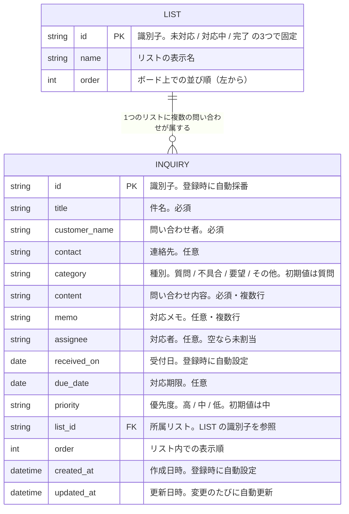
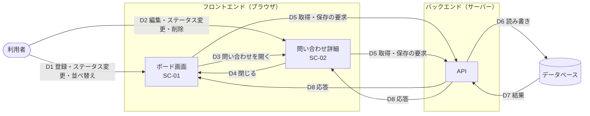
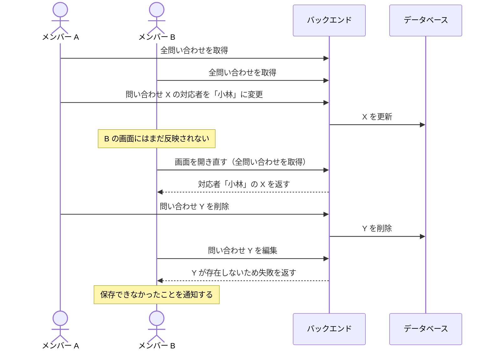

# 問い合わせ管理アプリ データ要件書

## 1. 文書情報

| 項目 | 内容 |
| --- | --- |
| 文書名 | 問い合わせ管理アプリ データ要件書 |
| 版数 | 1.0 |
| 作成日 | 2026-10-31 |
| 最終更新日 | 2026-10-31 |
| 作成者 | KeiT0773 |
| ステータス | 作成中（レビュー待ち） |
| 上位文書 | [要件定義書](requirements.md) |
| 関連文書 | [機能要件書](functional-requirements.md)、[画面要件書](screen-requirements.md) |
| 下位文書 | データ設計書（作成予定） |

本書は、本システムがデータベースに保持すべき情報と、その構造・流れを定義する。具体的な格納形式（テーブル定義、型、桁数）は基本設計で決定し、データ設計書に定義する。各項目に関連する機能（FR-xx）の内容は [機能要件書](functional-requirements.md) を、画面（SC-xx）は [画面要件書](screen-requirements.md) を参照すること。本書中の「決定事項 No.xx」は要件定義書「10. 決定事項」を指す。

### 1.1 変更履歴

| 版数 | 日付 | 変更内容 | 変更者 |
| --- | --- | --- | --- |
| 1.0 | 2026-10-31 | 初版作成。要件定義書 1.0 版の「6.3 データの概要」をもとに、問い合わせ・リストが持つ情報、入力できる文字数の上限、ER 図、データフロー図を定義。機能要件書 3.1 の変更に合わせ、対応期限が並び順に使われることを追記 | KeiT0773 |

---

## 2. 問い合わせが持つ情報

| 項目 | 種別 | 設定者 | 必須/任意 | 説明 |
| --- | --- | --- | --- | --- |
| 識別子 | 文字列 | システム | 必須 | 問い合わせを一意に識別するための値。登録時に自動で採番する |
| 件名 | 文字列 | 利用者 | 必須 | カード上に表示される問い合わせの見出し。空欄では登録・保存できない（FR-01, FR-02） |
| 問い合わせ者 | 文字列 | 利用者 | 必須 | 問い合わせをしてきた人の名前。空欄では登録・保存できない（FR-01, FR-02） |
| 連絡先 | 文字列 | 利用者 | 任意 | メールアドレスまたは電話番号。形式は検査しない。登録後に設定する（FR-02） |
| 種別 | 区分（質問／不具合／要望／その他） | 利用者 | 必須 | 問い合わせの分類。登録時に利用者が選ぶ。選ばない場合は「質問」とする（FR-01, FR-02） |
| 問い合わせ内容 | 文字列（複数行） | 利用者 | 必須 | 問い合わせ者から寄せられた内容。空欄では登録・保存できない（FR-01, FR-02） |
| 対応メモ | 文字列（複数行） | 利用者 | 任意 | 回答した内容や対応の経過。登録後に設定する（FR-02） |
| 対応者 | 文字列 | 利用者 | 任意 | 担当するメンバーの名前。自由入力。空の場合は「未割当」として扱う（FR-06） |
| 受付日 | 日付 | システム | 必須 | 問い合わせを登録した日付。登録時に自動で設定し、以後は変更しない（FR-01、決定事項 No.14） |
| 対応期限 | 日付 | 利用者 | 任意 | 対応を完了すべき日付。未設定を許容する（FR-07）。優先度順の並べ替えで、同じ優先度の中の並び順にも使う（機能要件書 3.1） |
| 優先度 | 区分（高／中／低） | 利用者 | 必須 | 登録時に利用者が選ぶ。選ばない場合は「中」とする（FR-01, FR-08） |
| 所属リスト | 区分（未対応／対応中／完了） | システム | 必須 | 問い合わせのステータス。登録時は必ず「未対応」とし、ステータス変更により変化する（FR-01, FR-04、決定事項 No.10） |
| 表示順 | 数値 | システム | 必須 | リスト内での並び順。ドラッグによる並べ替え・ステータス変更のほか、問い合わせ登録・優先度変更後の優先度順並べ替え、全リストの優先度順並べ替えでも変化する（FR-01, FR-04, FR-05, FR-08, FR-10） |
| 作成日時 | 日時 | システム | 必須 | 問い合わせが登録された日時。登録時に自動で設定する |
| 更新日時 | 日時 | システム | 必須 | 問い合わせが最後に変更された日時。登録・編集・ステータス変更・並べ替えのたびに自動で更新する |

**凡例**

- **必須**：常に値が入っている必要がある項目。
- **任意**：値が空のままでもよい項目。空の場合に画面上で何を表示するかは[画面要件書](screen-requirements.md)に定める（対応者の「未割当」、対応期限の空欄など）。
- **設定者**：その値を誰が決めるかを示す。「利用者」は画面から入力する項目、「システム」は利用者の操作に応じて自動的に設定される項目を指す。

### 2.1 入力できる文字数の上限

利用者が入力する文字列の項目には、次の上限を設ける。上限は、前後の空白を取り除いた後の文字数で判定する。画面では上限を超える入力をさせないようにし、バックエンドでも同じ上限で検査する。

| 項目 | 上限 | 備考 |
| --- | --- | --- |
| 件名 | 100 文字 | |
| 問い合わせ者 | 50 文字 | |
| 連絡先 | 100 文字 | |
| 問い合わせ内容 | 2,000 文字 | 改行を含む |
| 対応メモ | 2,000 文字 | 改行を含む |
| 対応者 | 50 文字 | |

### 2.2 空の値の扱い

- 文字列の項目は、前後の空白を取り除いてから保存する。取り除いた結果が空になる場合、任意項目（連絡先・対応メモ・対応者）は「値なし」として保存し、必須項目（件名・問い合わせ者・問い合わせ内容）は保存しない（FR-01, FR-02）。
- 対応期限を解除した場合は「値なし」として保存する（FR-07）。
- 空文字と「値なし」を区別しない。具体的な表現（`NULL` など）はデータ設計書で定める。

### 2.3 個人情報の扱い

問い合わせ者・連絡先は、問い合わせ者個人を特定できる情報（個人情報）である。問い合わせ内容・対応メモにも個人情報が含まれうる。これらは本システムの外に出さず、次のとおり扱う。

- データベースはインターネットから直接アクセスできない構成とし、必ずバックエンドを経由する（要件定義書 7.「データ保護」）。
- 通信は HTTPS で暗号化する（要件定義書 7.「通信の保護」）。
- 本バージョンでは、データの書き出し機能を提供しない（要件定義書 8.）。
- 削除した問い合わせは、データベースからも削除する（削除済みの印を付けて残すことはしない）。

---

## 3. リストが持つ情報

リストは「未対応」「対応中」「完了」の3つで固定とし、利用者による変更は行わない（決定事項 No.1）。そのため、リストの情報はデータベースに初期データとして登録し、以後は変更しない。

| 項目 | 説明 |
| --- | --- |
| 識別子 | リストを一意に識別するための値 |
| 名称 | 画面に表示するリストの名前（未対応 / 対応中 / 完了） |
| 並び順 | ボード上での並び順（左から 未対応 → 対応中 → 完了） |

種別（質問 / 不具合 / 要望 / その他）と優先度（高 / 中 / 低）も固定の区分であり、利用者による変更は行わない。これらを独立したデータとして持つか、問い合わせの項目の値として持つかはデータ設計書で定める。

---

## 4. ER図（データの構造）

データベースに保管する情報のかたまり（エンティティ）と、その関係を示す。基本設計では、この図をもとにテーブル定義を作成する。

| 図中の名称 | 本書での用語 | 説明 |
| --- | --- | --- |
| LIST | リスト（ステータス） | 3件で固定。利用者は追加・削除・変更できない（3.） |
| INQUIRY | 問い合わせ | 利用者が登録する問い合わせ1件。項目の詳細は 2. のとおり |

- 線の記号 `||--o{` は「LIST 1件に対して INQUIRY が 0件以上属する」ことを表す。問い合わせが1件もないリストも存在しうる。
- 問い合わせは必ずいずれか1つのリストに属する。リストに属さない問い合わせは存在しない。
- `PK` はそのエンティティを一意に識別する項目、`FK` は他のエンティティを参照する項目を示す。
- 対応者はメンバーを表すデータを参照せず、名前の文字列をそのまま持つ（決定事項 No.12。メンバーの登録は対象外）。
- 図中の英字の項目名は説明のための仮の名前であり、実際のテーブル名・列名はデータ設計書で定める。

---

## 5. データフロー図（データの流れ）

利用者の操作によって、データが3つの層（フロントエンド・バックエンド・データベース。[要件定義書](requirements.md)「2.4 システム構成」参照）の間をどう流れるかを示す。

| No | 流れ | 内容 | 関連機能 |
| --- | --- | --- | --- |
| D1 | 利用者 → ボード画面 | 問い合わせの登録、列の間の移動（ステータス変更）、列内の並べ替え、全リストの優先度順並べ替え | FR-01, FR-04, FR-05, FR-10 |
| D2 | 利用者 → 問い合わせ詳細 | 件名・問い合わせ者・連絡先・種別・問い合わせ内容・対応メモ・対応者・対応期限・優先度・ステータスの変更、問い合わせの削除 | FR-02, FR-03, FR-04, FR-06, FR-07, FR-08 |
| D3 | ボード画面 → 問い合わせ詳細 | カードをクリックし、その問い合わせの内容を詳細画面に表示する | SC-02 |
| D4 | 問い合わせ詳細 → ボード画面 | 詳細画面を閉じ、編集結果をボード画面に反映する | SC-01 |
| D5 | フロントエンド → バックエンド | アプリを開いたとき（再読み込みを含む）の「全問い合わせの取得」要求と、D1・D2 の操作のたびに発生する「登録・更新・削除」要求を API 経由で送る | FR-09 |
| D6 | バックエンド → データベース | 要求内容を検証し、データベースを読み書きする | FR-09 |
| D7 | データベース → バックエンド | 読み書きの結果（取得した問い合わせ、保存の成否）を返す | FR-09 |
| D8 | バックエンド → フロントエンド | 結果を画面に返す。取得時は問い合わせの一覧を、保存時は成否を返し、失敗した場合は画面が利用者に通知する | FR-09 |

- 利用者・フロントエンドがデータベースに直接触れることはなく、必ずバックエンドの API を経由する（[要件定義書](requirements.md)「7. 非機能要件」データ保護）。
- API の具体的な仕様（要求・応答の形式、一覧）は基本設計で定める。

### 5.1 複数のメンバーが同時に使うときの流れ

チームの複数のメンバーが、それぞれのブラウザで同じボードを開いている場合の流れを示す（決定事項 No.17）。

- 各メンバーの画面は、取得した時点のデータを表示する。ほかのメンバーの変更は、画面を開き直して D5 の取得を行うまで反映されない。
- 同じ問い合わせを複数のメンバーが編集した場合は、後から届いた更新の内容で上書きする（後勝ち）。
- 更新は、操作した問い合わせ（と、並べ替えで表示順が変わる同じリストの問い合わせ）だけを対象とする。操作していない問い合わせの件名・内容などを、画面が持っている古い値で書き戻さないこと（要件定義書 7.「同時利用」）。
- 存在しない（削除済みの）問い合わせへの更新・削除の要求は失敗として返し、画面が利用者に通知する。
