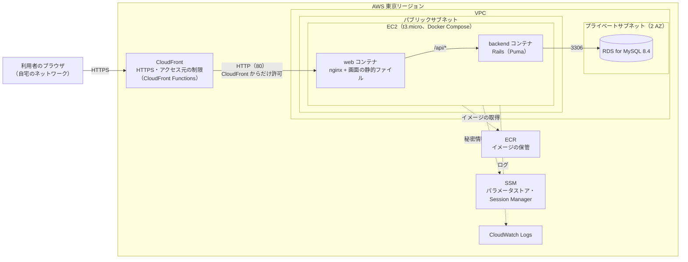
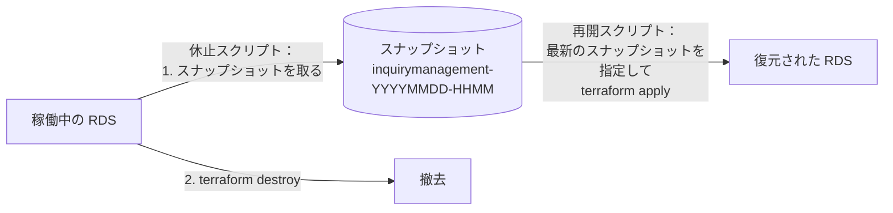

# 問い合わせ管理アプリ インフラ設計書

## 1. 文書情報

| 項目 | 内容 |
| --- | --- |
| 文書名 | 問い合わせ管理アプリ インフラ設計書 |
| 版数 | 1.1 |
| 作成日 | 2026-10-31 |
| 最終更新日 | 2026-10-31 |
| 作成者 | KeiT0773 |
| ステータス | 作成中（レビュー待ち） |
| 上位文書 | [要件定義書](requirements.md)、[技術スタック](tech-stack.md) |
| 関連文書 | [データ設計書](data-design.md)、[API 設計書](api-design.md)、[フロントエンド設計書](frontend-design.md)、AWS デプロイ手順書（作成予定） |

本書は、[技術スタック](tech-stack.md) 9. で選んだ AWS のサービスを、**どう組み合わせ、どう設定するか** を定義する。構築・更新・休止・再開の操作手順は AWS デプロイ手順書（作成予定）に、Claude が守る約束はスキル `deploy-aws` に書く。

本書は、タスク管理アプリのインフラ設計書の構成と方針（休止は撤去、アクセス元の制限、秘密情報の扱い、Terraform の構成）を踏襲する。サーバーレス構成（S3・ECS on Fargate・ALB）を、EC2 1 台の構成に置き換えたことによる違いは「13. 決定事項」の「タスク管理アプリとの違い」欄に示す。

### 1.1 変更履歴

| 版数 | 日付 | 変更内容 | 変更者 |
| --- | --- | --- | --- |
| 1.0 | 2026-10-31 | 初版作成。CloudFront + EC2（Docker Compose で nginx と Rails）+ RDS for MySQL の構成、ネットワーク、秘密情報、IAM、費用、Terraform の構成を定義 | KeiT0773 |
| 1.1 | 2026-10-31 | データ設計書 1.3 版に合わせ、8. の新規作成時のテーブルと `lists` の初期データの作られ方を訂正（マイグレーションではなく `schema.rb` と `db/seeds.rb`） | KeiT0773 |

---

## 2. 設計方針

| No | 方針 | 理由 |
| --- | --- | --- |
| 1 | 構成は「CloudFront（入口）＋ EC2 1 台（画面の配信と API）＋ マネージド DB（RDS）」とする | プロジェクト方針（[技術スタック](tech-stack.md) 2.）。タスク管理アプリのサーバーレス構成と違い、サーバーの OS とプロセスを自分で管理する構成を学ぶ |
| 2 | 画面と API を **同じドメイン（CloudFront）から配信** する。EC2 上の nginx が画面の静的ファイルを返し、`/api/*` だけを Rails へ転送する | 本番では CORS が不要になる（[API 設計書](api-design.md) 2. 方針 10）。フロントエンドは本番で `/api` を呼ぶ（[フロントエンド設計書](frontend-design.md) 9.） |
| 3 | 利用者が入れる入口は **CloudFront だけ** にする。EC2 は CloudFront からの通信だけを受け付け、RDS は EC2 からだけ受け付ける。CloudFront で、**利用者の自宅のネットワーク以外からの要求を拒否する**（6.4） | 要件定義書 7.「データ保護」「アクセス制御」。入口を 1 つに絞れば、制限もそこ 1 か所で済む |
| 4 | EC2 は **使い捨て** にする。データはすべて RDS に置き、ログは CloudWatch Logs に送る。EC2 の中で手作業の設定をしない（起動時の設定はすべて Terraform の `user_data` で行う） | EC2 を作り直しても何も失われないようにする。休止・再開（方針 8）や設定の変更のたびに、同じ状態の EC2 を作れる |
| 5 | EC2 の上では、nginx と Rails を **Docker Compose** で動かす | ローカルと同じ Docker イメージを使い、環境の違いによる不具合を防ぐ（[技術スタック](tech-stack.md) 8. No.5） |
| 6 | すべてのリソースを Terraform で定義し、コンソールでは変更しない | 構成をコードとして残し、いつでも同じ環境を作り直せるようにする |
| 7 | 費用を抑えるため、冗長化（マルチ AZ の DB、複数台の EC2）・ロードバランサー・NAT Gateway は使わない | 利用者は数名で、サーバーの監視・自動復旧は対象外（要件定義書 4.2）。可用性より費用を優先する |
| 8 | **使わない期間は、すべてのリソースを `terraform destroy` で撤去する（休止）。** 使うときに作り直す（再開）。登録した問い合わせは、休止の直前に取る DB のスナップショットで次の再開に引き継ぐ | 費用の大半は、リソースが存在している時間に比例する。タスク管理アプリと同じ方式 |
| 9 | **各リソースは、無料利用枠の対象と同じ規模を上限とする**（2.1） | [要件定義書](requirements.md) 7.「費用」 |
| 10 | 独自ドメインは取得せず、CloudFront が発行する `https://xxxx.cloudfront.net` を使う | HTTPS（要件定義書 7.「通信の保護」）を CloudFront の既定の証明書で満たせる |
| 11 | 環境は本番 1 つだけとする | 動作確認はローカル環境で行う |

### 2.1 リソースの上限（無料利用枠と同じ規模）

本システムで使う AWS アカウントは、無料利用枠の期間を過ぎている（タスク管理アプリで 2026-10-17 に確認）。そのため無料利用枠の対象になるリソースでも課金されるが、**規模は無料利用枠と同じ範囲に収め、これより大きな構成にはしない**。上限を超える変更が必要になったときは、要件定義書 7.「費用」の改訂から行う。

| リソース | 上限（これより大きくしない） | 無料利用枠との対応 |
| --- | --- | --- |
| EC2 | `t3.micro`（2 vCPU / 1 GB）を 1 台。ルートボリュームは gp3 20 GB | 旧来の無料利用枠（micro クラス 月 750 時間、EBS 30 GB）と同じ規模 |
| RDS | `db.t4g.micro`（または `db.t3.micro`）を 1 台、シングル AZ、gp3 20 GB。ストレージの自動拡張・リードレプリカ・Performance Insights の長期保持・拡張モニタリングは使わない | 旧来の無料利用枠（micro クラス 月 750 時間、ストレージ 20 GB）と同じ規模 |
| パブリック IPv4 アドレス | 1 個（EC2） | 旧来の無料利用枠（月 750 時間）と同じ数 |
| 秘密情報の保管 | SSM パラメータストアの標準パラメータ（9.） | 常時無料。有料の Secrets Manager は使わない |
| CloudFront | ディストリビューション 1 つ | 常時無料の範囲（月 1 TB・1,000 万リクエスト）に収まる |
| CloudFront Functions | 関数 1 つ（アクセス元の制限。6.4） | 常時無料の範囲（月 200 万回）に収まる |
| CloudWatch Logs | ロググループ 2 つ、保持 7 日 | 常時無料の範囲（月 5 GB）に収まる |
| ECR | リポジトリ 2 つ（Rails・Web）。古いイメージは自動で消す | 保管量は数百 MB で、休止のたびに消える |

---

## 3. システム構成

### 3.1 構成図



### 3.2 リクエストの流れ

| 要求 | 流れ |
| --- | --- |
| 画面（`/`、`/_next/...` など） | ブラウザ →（HTTPS）→ CloudFront（アクセス元の判定）→（HTTP）→ EC2 の web コンテナ（nginx が静的ファイルを返す） |
| API（`/api/*`） | ブラウザ →（HTTPS）→ CloudFront（アクセス元の判定）→（HTTP）→ EC2 の web コンテナ（nginx）→ backend コンテナ（Rails）→ RDS |

### 3.3 ローカル環境との対応

| 役割 | ローカル | 本番 |
| --- | --- | --- |
| 画面 | `npm run dev`（Next.js の開発サーバー、3000） | `npm run build` で書き出した静的ファイルを、web コンテナの nginx が返す |
| API | Docker Compose の backend コンテナ（Rails、3001） | EC2 上の Docker Compose の backend コンテナ（Rails。EC2 の外には公開しない） |
| DB | Docker Compose の MySQL 8.4（3306） | RDS for MySQL 8.4 |
| 画面から API への接続 | `http://localhost:3001` を直接呼ぶ（CORS） | 同じドメインの `/api`（nginx が転送） |

---

## 4. 使用するサービス

| サービス | 用途 |
| --- | --- |
| Amazon CloudFront | 入口。HTTPS、アクセス元の制限（CloudFront Functions）、画面の静的ファイルのキャッシュ |
| Amazon EC2 | nginx と Rails を Docker Compose で動かすサーバー 1 台 |
| Amazon RDS for MySQL | データベース |
| Amazon VPC | ネットワーク（サブネット、インターネットゲートウェイ、セキュリティグループ） |
| Amazon ECR | Docker イメージの保管（backend・web の 2 つ） |
| AWS Systems Manager（SSM） | パラメータストア（秘密情報とイメージのタグ）、Session Manager（EC2 への接続）、Run Command（デプロイ時に EC2 でコマンドを実行） |
| Amazon CloudWatch Logs | コンテナのログ |
| AWS IAM | EC2 が他のサービスを使うためのロール |
| AWS Budgets | 予算アラート（11.3） |
| Amazon S3 | Terraform の state の保存先（12.4） |

---

## 5. ネットワーク設計

### 5.1 VPC とサブネット

| 項目 | 値 | 理由 |
| --- | --- | --- |
| VPC | `10.20.0.0/16` | タスク管理アプリ（同じアカウント）と重ならない範囲にしておく |
| パブリックサブネット | `10.20.1.0/24`（`ap-northeast-1a`）。インターネットゲートウェイへの経路を持つ | EC2 を置く。EC2 がイメージの取得・OS の更新・SSM との通信のために外へ出られるようにする |
| プライベートサブネット | `10.20.11.0/24`（`ap-northeast-1a`）、`10.20.12.0/24`（`ap-northeast-1c`）。外への経路を持たない | RDS を置く。RDS のサブネットグループは 2 つ以上の AZ のサブネットを必要とするため 2 つ作る（DB 自体は 1 台） |
| IPv6 | VPC では使わない | 利用者のブラウザと CloudFront の間は IPv6 で通信する（6.4）が、CloudFront と EC2 の間は IPv4 でよい |

### 5.2 EC2 をパブリックサブネットに置く理由

EC2 は外から直接呼ばれたくないため、本来はプライベートサブネットに置きたい。CloudFront にはプライベートサブネットの EC2 に直接つなぐ機能（VPC オリジン）もある。しかし、プライベートサブネットの EC2 がイメージを取得したり OS を更新したりするには、外へ出る経路として **NAT Gateway（月 45 ドル前後）** か、ECR・SSM などの **VPC エンドポイント（1 つあたり月 7 ドル前後 × 4〜5 個）** が必要になり、要件定義書 7.「費用」と相反する。

そこで EC2 はパブリックサブネットに置き、パブリック IPv4 アドレス（月 4 ドル前後）を持たせる。そのうえで、外から直接呼ばれないように次の 2 段で守る（6.2）。

1. セキュリティグループで、**CloudFront の送信元（AWS が管理するアドレスの一覧）からの 80 番だけ** を受け付ける。
2. CloudFront が付ける **秘密のヘッダー** が無い要求を、nginx が 403 で拒否する（他人の CloudFront から送られた要求を拒否するため）。

### 5.3 セキュリティグループ

| 名前 | 対象 | 受信（インバウンド） | 送信（アウトバウンド） |
| --- | --- | --- | --- |
| `ec2` | EC2 | TCP 80：送信元は CloudFront のマネージドプレフィックスリスト（`com.amazonaws.global.cloudfront.origin-facing`）だけ。**SSH（22）は開けない** | すべて許可（イメージの取得、OS の更新、SSM、RDS への接続） |
| `rds` | RDS | TCP 3306：送信元は `ec2` のセキュリティグループだけ | なし |

EC2 に入る必要があるとき（障害の調査など）は、SSH ではなく **SSM Session Manager**（AWS CLI またはコンソールから、ポートを開けずにシェルを開ける仕組み）を使う。鍵の管理が要らず、22 番を開けなくて済む。

---

## 6. CloudFront の設計

### 6.1 オリジンとビヘイビア

オリジン（CloudFront の転送先）は EC2 の 1 つだけで、`/api/*` とそれ以外でキャッシュの扱いを分ける。

| 項目 | 値 |
| --- | --- |
| オリジン | EC2 のパブリック DNS 名（`ec2-xx-xx-xx-xx.ap-northeast-1.compute.amazonaws.com`）。プロトコルは HTTP、ポート 80 |
| オリジンに付けるヘッダー | `X-Origin-Verify: <秘密の値>`（6.2） |
| ビヘイビア `/api/*` | キャッシュしない（マネージドポリシー `CachingDisabled`）。要求のヘッダー・クエリ・body をそのまま転送する（`AllViewerExceptHostHeader`）。許可するメソッドは GET・HEAD・OPTIONS・PUT・POST・PATCH・DELETE |
| ビヘイビア `*`（既定） | 画面の静的ファイル。キャッシュする（`CachingOptimized`）。許可するメソッドは GET・HEAD |
| 両方のビヘイビア | ビューワーリクエストに CloudFront Functions（6.4）を付ける。HTTP で来た要求は HTTPS へ転送（`redirect-to-https`） |
| IPv6 | 有効（`is_ipv6_enabled = true`。6.4） |
| 価格クラス | `PriceClass_200`（日本を含む） |

画面を更新したときは、デプロイのスクリプトが CloudFront のキャッシュを無効化する（`/*`）。Next.js が書き出す JavaScript・CSS のファイル名には内容に応じた値が付く（中身が変わればファイル名も変わる）ため、無効化が必要なのは実質 HTML だけである。

### 6.2 EC2 を外から直接呼ばせない

5.2 のとおり、EC2 はパブリック IP を持つ。CloudFront を通らない要求を次の 2 段で拒否する。

| 段 | 仕組み | 防げるもの |
| --- | --- | --- |
| 1 | セキュリティグループの受信を、CloudFront のマネージドプレフィックスリストに限る | インターネット上の任意の送信元から EC2 への直接の要求 |
| 2 | CloudFront がオリジンへの要求に付ける `X-Origin-Verify` ヘッダーの値を nginx が確かめ、一致しなければ 403 を返す。値は Terraform が生成する 32 文字の乱数（9.） | **他人が作った CloudFront** から EC2 への要求（プレフィックスリストは全 CloudFront 共通のため、1 段目だけでは防げない） |

### 6.3 通信の暗号化

| 区間 | 暗号化 | 補足 |
| --- | --- | --- |
| ブラウザ ↔ CloudFront | HTTPS（TLS 1.2 以上） | CloudFront の既定の証明書（`*.cloudfront.net`）。要件定義書 7.「通信の保護」はこの区間で満たす |
| CloudFront ↔ EC2 | **HTTP（暗号化しない）** | EC2 のパブリック DNS 名に対して、一般に信頼される証明書を取得できない（独自ドメインを持たないため）。CloudFront はオリジンとの HTTPS で証明書の正しさを検証するため、自己署名の証明書は使えない。この区間は AWS のネットワークの中を通る |
| EC2 内（nginx ↔ Rails） | HTTP | 同じ EC2 の中の Docker のネットワーク |
| Rails ↔ RDS | TLS | RDS for MySQL は TLS での接続に対応している。Rails の接続設定で `ssl_mode: required` にする |

CloudFront と EC2 の間を暗号化しないことは、タスク管理アプリ（CloudFront と内部 ALB の間は HTTP。ただし VPC の中）と比べて弱くなる点である。独自ドメインを取得すれば HTTPS にできる（14. 保留事項）。

### 6.4 アクセス元の制限（自宅のネットワークだけ）

[要件定義書](requirements.md) 7.「アクセス制御」に従い、利用者の自宅のネットワーク以外からの要求を拒否する。**仕組みはタスク管理アプリと同じ** で、関数のコード（`infra/terraform/functions/viewer-allowlist.js`）とその単体テストもタスク管理アプリのものを流用する。

| 項目 | 決定 | 理由 |
| --- | --- | --- |
| 判定する場所 | CloudFront（入口）の 2 つのビヘイビア（`*` と `/api/*`）の両方 | 外から入れる入口は CloudFront だけ（6.2）なので、ここで止めれば画面も API も守れる |
| 方式 | CloudFront Functions（`cloudfront-js-2.0`）のビューワーリクエスト | 月 200 万回まで無料。同じことができる AWS WAF は月 6 ドル前後かかる |
| 判定に使うアドレス | IPv6 のネットワーク番号（先頭 64 ビット、`/64`） | 後半 64 ビットは PC が自動で変えるが、前半（自宅のネットワークの番号）は変わりにくい |
| IPv4 | すべて拒否する | IPv4 アドレスは複数の契約者で共有されていることがあり、許可すると他人も入れてしまうおそれがある |
| 拒否したときの応答 | `403 Forbidden`、本文は短い日本語の説明 | 画面のファイルも API も返さない |
| 許可リストの置き場所 | Terraform の変数 `allowed_viewer_ipv6_prefixes`（`terraform.tfvars`。Git に入れない） | 関数は外部の設定を読めないため、値をコードに埋め込む |
| 許可リストの取得 | 再開（`startup.sh`）のたびに、PC の IPv6 アドレスを調べて先頭 64 ビットを書く。稼働中に変わったら `update-allowed-ip.sh` で更新する | タスク管理アプリと同じ |
| 空の許可リスト | CloudFront を作らずに止める（precondition） | 誰もアクセスできない状態で構築されるのを防ぐ |

チームのメンバーも、自宅のネットワーク（許可したネットワーク）につながった端末からしか利用できない（要件定義書 8.）。メンバーが別の場所から使う必要が出たら、許可リストへの追加か、認証の導入を検討する（14.）。

---

## 7. EC2 の設計

### 7.1 インスタンス

| 項目 | 値 | 理由 |
| --- | --- | --- |
| インスタンスタイプ | `t3.micro`（2 vCPU / 1 GB、x86_64） | 無料利用枠と同じ規模（2.1）。開発者の PC（Windows、x86_64）で作った Docker イメージをそのまま動かせるよう、CPU の種類を x86_64 にそろえる。ARM の `t4g.micro` は少し安いが、PC で ARM 向けのイメージを作るには時間のかかる変換が要る |
| AMI | Amazon Linux 2023 の最新（Terraform が SSM の公開パラメータから取得する） | AWS が保守している。SSM のエージェントが最初から入っている |
| ルートボリューム | gp3 20 GB、暗号化あり | Docker のイメージとコンテナのための容量。上限（2.1）の範囲 |
| メモリの不足への備え | スワップ 1 GB をファイルで作る（`user_data`） | 1 GB のメモリで nginx・Rails（Puma）・Docker を動かすため、一時的な不足でプロセスが強制終了されないようにする |
| キーペア | 作らない | SSH を使わず、SSM Session Manager で入る（5.3） |
| IMDS | v2 だけを許可（`http_tokens = "required"`） | インスタンスのメタデータ（ロールの認証情報など）を、より安全な方式でだけ読めるようにする |

### 7.2 起動時の設定（`user_data`）

EC2 の初回起動時に、Terraform が `user_data`（起動時に 1 回だけ実行されるスクリプト）で次を行う。EC2 の中で手作業の設定はしない（2. 方針 4）。

1. Docker と Docker Compose のプラグインを入れ、Docker を自動起動にする。
2. スワップファイルを作る。
3. `/opt/inquirymanagement/` に、本番用の `compose.yaml`（7.3）と、起動スクリプト `start.sh` を置く。
4. systemd のサービス `inquirymanagement.service` を登録する。起動時に `start.sh` を実行し、SSM パラメータストアから秘密情報とイメージのタグを読んで `.env`（root だけが読める）に書き出し、ECR にログインして `docker compose up -d` する。
5. サービスを起動する。

`user_data` の内容を変えたときは EC2 を作り直す（`user_data_replace_on_change = true`）。EC2 は使い捨て（2. 方針 4）なので、作り直しても失われるものは無い。作り直すと EC2 のパブリック DNS 名が変わるが、CloudFront のオリジンも Terraform が同時に更新する。

### 7.3 コンテナの構成（本番の `compose.yaml`）

| コンテナ | イメージ | 役割 | ポート |
| --- | --- | --- | --- |
| `web` | ECR の `inquirymanagement-web`。nginx の公式イメージに、Next.js が書き出した静的ファイルと nginx の設定を入れたもの | 静的ファイルを返し、`/api/*` を `backend` へ転送する。`X-Origin-Verify` ヘッダーを確かめる（6.2） | EC2 の 80 番で受ける |
| `backend` | ECR の `inquirymanagement-backend`。Rails の雛形の `Dockerfile`（本番用）で作ったもの | API（Puma）。起動時に `bin/rails db:prepare` で未適用のマイグレーションを適用する（Rails の雛形の `docker-entrypoint` の動作） | EC2 の外には公開しない（Docker のネットワークの中だけ） |

| 項目 | 決定 |
| --- | --- |
| 再起動 | 両方のコンテナに `restart: unless-stopped`。プロセスが落ちても Docker が起動し直す。EC2 の再起動後は systemd のサービスが起動する |
| ログ | Docker の `awslogs` ログドライバーで、CloudWatch Logs の `/inquirymanagement/web` と `/inquirymanagement/backend` に送る（保持 7 日） |
| Rails の環境変数 | `RAILS_ENV=production`、`DATABASE_HOST`・`DATABASE_USERNAME`・`DATABASE_PASSWORD`（9.）、`SECRET_KEY_BASE`（9.） |
| Rails の HTTPS の設定 | 利用者との HTTPS は CloudFront が受け持ち、Rails には HTTP で届く。Rails 8 の本番の雛形にある `config.assume_ssl = true`（前段で HTTPS が終わっているとみなす）と `config.force_ssl = true` をそのまま使う。`assume_ssl` が無いと、Rails が HTTP の要求を HTTPS へ転送し続けてしまう。`/up` は `force_ssl` の対象から外す（EC2 の中から HTTP で確かめるため） |
| 死活確認 | `backend` は Rails の `GET /up`。デプロイのスクリプトが SSM Run Command で EC2 の中から `curl` して確かめる（`/up` は nginx で外へは転送しない） |

### 7.4 イメージのタグとデプロイ

| 項目 | 決定 |
| --- | --- |
| イメージの作成 | 開発者の PC（Docker Desktop）で作る。web イメージは、`frontend/` で `npm run build` してからその出力を入れる |
| タグ | Git のコミットの短いハッシュ（例：`a1b2c3d`）。`latest` は使わない。どのコードが動いているかをタグで分かるようにする |
| 動いているタグの記録 | SSM パラメータストアの `/inquirymanagement/backend-image-tag`・`/inquirymanagement/web-image-tag` |
| EC2 への反映 | デプロイのスクリプトが、イメージを ECR に登録し、タグのパラメータを更新してから、SSM Run Command で EC2 の `start.sh` を実行する（新しいタグのイメージを取得して `docker compose up -d`） |
| 古いイメージ | ECR のライフサイクルポリシーで、各リポジトリの最新 5 つだけを残す |

---

## 8. データベース（RDS）の設計

| 項目 | 値 | 理由 |
| --- | --- | --- |
| エンジン | MySQL 8.4 系 | ローカル（`compose.yaml` の `mysql:8.4`）と同じ系列（[技術スタック](tech-stack.md) 5.） |
| インスタンスクラス | `db.t4g.micro`（2 vCPU / 1 GB） | RDS で最小級。想定データ量（問い合わせ 300 件程度）には十分。RDS は AWS が動かすため、EC2 と違って CPU の種類（ARM）を気にしなくてよい |
| ストレージ | gp3 20 GB、暗号化あり、自動拡張なし | 無料利用枠と同じ規模（2.1） |
| 配置 | シングル AZ、プライベートサブネット | 2. 方針 7 |
| 外部公開 | `publicly_accessible = false` | 要件定義書 7.「データ保護」 |
| DB 名 / ユーザー名 | `inquirymanagement` / `inquirymanagement` | ローカル（`compose.yaml`）と同じ名前にそろえる |
| パラメータグループ | MySQL 8.4 の既定（文字コード `utf8mb4`、タイムゾーン UTC） | データ設計書 3.・5.4 の前提と一致する。日本時間への変換は Rails が行う |
| 接続の暗号化 | TLS を必須にする（Rails 側で `ssl_mode: required`。6.3） | 同じ VPC の中だが、DB のパスワードと個人情報が流れるため |
| 自動バックアップ | 保持 1 日 | RDS の既定機能を最小限で残す。休止（`destroy`）で DB と一緒に消える |
| 作成元 | 変数 `db_snapshot_identifier` が空なら新規作成、指定されていればそのスナップショットから復元 | 8.1 |
| 削除時のスナップショット | Terraform では取らない（`skip_final_snapshot = true`）。休止のスクリプトが AWS CLI で取る | 8.1 |
| 削除保護 | 無効 | 休止のたびに撤去するため |

テーブルは Terraform では作らない。新規作成のときは、backend コンテナの起動時に `bin/rails db:prepare` が、DB が空であることを見て `db/schema.rb` からテーブルを作り、続けて `db/seeds.rb` で `lists` の初期データを入れる（[データ設計書](data-design.md) 10.2）。開発用のサンプルデータは本番では入らない（データ設計書 10.4）。スナップショットから復元したときは、マイグレーションの適用履歴も一緒に戻るため、未適用のものだけが適用される。

### 8.1 休止をまたいだデータの引き継ぎ

タスク管理アプリと同じ方式とする。



| 項目 | 決定 |
| --- | --- |
| スナップショットを取る主体 | 休止スクリプト（`shutdown.sh`）が AWS CLI で取り、完成を待ってから `terraform destroy` する |
| 名前 | `inquirymanagement-YYYYMMDD-HHMM`（休止した日時） |
| 復元に使うスナップショット | 再開スクリプト（`startup.sh`）が最新のものを探し、`db_snapshot_identifier` として Terraform に渡す |
| 保管する数 | 最新の 2 つ。それより古いものは休止スクリプトが消す |
| 初回・データを捨てたいとき | `db_snapshot_identifier` を空にして新規作成する |

スナップショットには問い合わせ者の氏名・連絡先（個人情報）が含まれる。暗号化された状態で保管され、本アカウントの外には共有しない。

---

## 9. 秘密情報の扱い

| 秘密情報 | 生成 | 保管 | 使う側 |
| --- | --- | --- | --- |
| DB のマスターパスワード | Terraform の `random_password`（32 文字） | SSM パラメータストア `/inquirymanagement/db-password`（`SecureString`） | RDS（作成時）、`start.sh` が読んで backend コンテナの `DATABASE_PASSWORD` に渡す |
| Rails の `SECRET_KEY_BASE` | Terraform の `random_password`（64 文字） | `/inquirymanagement/secret-key-base`（`SecureString`） | `start.sh` が読んで backend コンテナに渡す |
| オリジンの確認用ヘッダーの値 | Terraform の `random_password`（32 文字） | `/inquirymanagement/origin-verify`（`SecureString`）。CloudFront のオリジンの設定にも入る | `start.sh` が読んで web コンテナの nginx の設定に渡す（6.2） |

- 秘密の値はリポジトリにも、`compose.yaml` にも、`user_data` にも書かない。`user_data` と `start.sh` には「パラメータの名前」だけを書き、値は起動のたびに SSM から読む。
- Rails の暗号化された資格情報（`config/credentials.yml.enc` と `config/master.key`）は本番では使わない。本番が必要とする秘密は `SECRET_KEY_BASE` だけで、環境変数で渡せるため。`config/master.key` はコミットしない。
- 保管先は、有料の Secrets Manager ではなく、**SSM パラメータストアの標準パラメータ（無料）** にする（タスク管理アプリと同じ）。
- 休止（`destroy`）でパラメータも消え、再開のたびに新しい値が生成される。
- **Terraform の state ファイルにはこれらの値が平文で記録される**。このため state を置く S3 バケットは、パブリックアクセス禁止・暗号化・バージョニングを必須とする（12.4）。
- Terraform と AWS CLI は、開発者の PC の `~/.aws/credentials` のアクセスキーで AWS を操作する。アクセスキーはコードにもリポジトリにも書かない。

---

## 10. IAM の設計

| ロール | 使う主体 | 許可する操作 |
| --- | --- | --- |
| EC2 のインスタンスロール | EC2（`start.sh`、Docker、SSM のエージェント） | SSM Session Manager と Run Command を受ける（AWS 管理ポリシー `AmazonSSMManagedInstanceCore`）。ECR からイメージを取得する（`ecr:GetAuthorizationToken` と、2 つのリポジトリに限った読み取り）。SSM パラメータストアの `/inquirymanagement/*` を読む（`ssm:GetParameter(s)`）。CloudWatch Logs の 2 つのロググループに書く |

`ecr:GetAuthorizationToken` だけは AWS の仕様で対象を絞れない（`Resource: "*"`）。それ以外の権限は、対象のリソースを ARN で指定する。

---

## 11. 費用見積もり

東京リージョンの単価をもとにした概算（2026-10 時点、税別）。無料利用枠は考慮しない。構築の前に AWS の料金ページで単価を確かめ、大きく違えば本書を更新する。

### 11.1 稼働中

| サービス | 内訳 | 1 時間あたり | 30 日間つけっぱなしの場合 |
| --- | --- | --- | --- |
| EC2 | `t3.micro` 1 台 | 約 0.014 ドル | 約 10 ドル |
| EBS | gp3 20 GB | 約 0.002 ドル | 約 2 ドル |
| パブリック IPv4 | EC2 の 1 個 | 約 0.005 ドル | 約 4 ドル |
| RDS | `db.t4g.micro` シングル AZ + gp3 20 GB | 約 0.029 ドル | 約 21 ドル |
| その他 | CloudFront、CloudFront Functions、ECR、SSM パラメータストア、CloudWatch Logs（大半は常時無料の範囲） | — | 約 1 ドル |
| **合計** | | **約 0.05 ドル** | **約 38 ドル** |

タスク管理アプリ（約 0.07 ドル / 時間）より安いのは、ロードバランサー（ALB）を使わないためである。例えば、1 日 8 時間 × 月 20 日だけ稼働させる（160 時間）なら、月 8 ドル前後になる。

### 11.2 休止中

| 残るもの | 月額の目安 |
| --- | --- |
| DB のスナップショット（最新 2 つ） | 数セント |
| Terraform の state 用 S3 バケット | 0.01 ドル未満 |
| AWS Budgets | 0 ドル |
| **合計** | **ほぼ 0 ドル** |

### 11.3 予算アラート

予算 20 ドル / 月の AWS Budgets を設定し、実績が予算の 80% を超えたときと、月末の予測が予算を超えそうなときにメールで知らせる。タスク管理アプリと同じアカウントのため、既存の予算を **アカウント全体** で共有するか、本プロジェクトのタグ（`Project = inquirymanagement`）で絞った予算を別に作るかは、構築時に決める（14.）。

---

## 12. Terraform の構成

### 12.1 リポジトリ上の配置

```
InquiryManagement/
└── infra/
    ├── terraform/                  Terraform のコード（1 環境のみ）
    │   ├── versions.tf             Terraform とプロバイダーのバージョン
    │   ├── backend.tf              state の保存先（S3）
    │   ├── variables.tf            入力値の定義
    │   ├── terraform.tfvars.example  入力値の記入例（実物の .tfvars はコミットしない）
    │   ├── network.tf              VPC、サブネット、ルートテーブル、セキュリティグループ
    │   ├── ecr.tf                  イメージの保管場所（backend・web）
    │   ├── ssm.tf                  秘密情報・イメージのタグのパラメータ、乱数の生成
    │   ├── rds.tf                  データベース
    │   ├── ec2.tf                  EC2、インスタンスロール、user_data
    │   ├── templates/
    │   │   ├── user_data.sh.tftpl  起動時の設定（7.2）
    │   │   ├── compose.yaml.tftpl  本番の Docker Compose の定義（7.3）
    │   │   └── start.sh.tftpl      秘密情報の取得とコンテナの起動
    │   ├── logs.tf                 CloudWatch Logs
    │   ├── cloudfront.tf           CloudFront、アクセス元を制限する関数
    │   ├── functions/
    │   │   ├── viewer-allowlist.js        アクセス元の制限（タスク管理アプリから流用。6.4）
    │   │   └── viewer-allowlist.test.mjs  上の関数の単体テスト（node で実行）
    │   ├── outputs.tf              URL などの出力値
    │   └── .terraform.lock.hcl     プロバイダーのバージョンの固定（コミットする）
    ├── docker/
    │   └── web/
    │       ├── Dockerfile          nginx + 画面の静的ファイル
    │       └── default.conf.template  nginx の設定（静的ファイル、/api の転送、ヘッダーの確認）
    ├── .gitignore                  .terraform/、*.tfstate、実物の *.tfvars、保存した計画を Git に含めない
    └── scripts/
        ├── lib.sh                  各スクリプトが共通で使う関数（確認、init、計画の検査など）
        ├── deploy-backend.sh       backend イメージの作成 → ECR へ登録 → EC2 に反映
        ├── deploy-frontend.sh      画面のビルド → web イメージの作成 → ECR へ登録 → EC2 に反映 → キャッシュの無効化
        ├── update-allowed-ip.sh    稼働中に自宅のネットワーク番号が変わったとき、許可リストだけを更新
        ├── shutdown.sh             休止：スナップショット → 古いスナップショットの削除 → terraform destroy
        └── startup.sh              再開：最新スナップショットの指定 → ECR → イメージ登録 → terraform apply → 起動の確認
```

- 1 環境のみのため、モジュールには分けず、役割ごとにファイルを分ける。
- web イメージの定義（`infra/docker/web/`）は、本番でだけ使うため `frontend/` ではなく `infra/` に置く。backend イメージは Rails の雛形の `backend/Dockerfile` をそのまま使う。

### 12.2 バージョンと共通設定

| 項目 | 値 | 理由 |
| --- | --- | --- |
| Terraform | 1.10 以上 | S3 だけで state のロックができる機能（`use_lockfile`）を使うため |
| AWS プロバイダー | `~> 6.0`（実際の版は `.terraform.lock.hcl` で固定） | メジャー版の更新で書き方が変わることがあるため |
| random プロバイダー | `~> 3.6` | 秘密の値の生成（9.） |
| リージョン | `ap-northeast-1`（東京） | 利用者が日本にいる |
| 共通タグ | `Project = inquirymanagement`、`ManagedBy = terraform` | 費用の内訳を絞り込んだり、タスク管理アプリのリソースと区別したりするため |

### 12.3 スクリプトの安全装置

タスク管理アプリと同じ安全装置を持たせる。

| 安全装置 | 内容 | 対象 |
| --- | --- | --- |
| 実行前の確認 | 作成・撤去する件数を表示し、`[y/N]` で確認を求める。`--yes` で省略できる。端末から入力できないときは、確認の手前で止まる | startup・shutdown・deploy-backend・deploy-frontend |
| 削除・作り直しの検査 | 保存した計画に削除・作り直し（`-/+`）が含まれていれば、適用せずに中止する。ただし EC2 の作り直し（`user_data` の変更による。7.2）は、内容を表示して確認を求めたうえで許可する。**RDS の作り直しは常に中止する** | startup・update-allowed-ip |
| スナップショットの完成の確認 | スナップショットが完成しなければ、何も撤去せずに中止する | shutdown |
| 未コミットの変更の検査 | `backend/`・`frontend/` にコミットしていない変更があれば、イメージを作らずに中止する（タグと中身を一致させるため） | startup・deploy-backend・deploy-frontend |
| 起動の確認 | 反映後に SSM Run Command で EC2 の中から `/up` を確かめ、CloudFront の URL で画面と `/api/lists` を確かめる | startup・deploy-backend・deploy-frontend |
| 許可リストの自動取得 | 再開のたびに、その時点の PC の IPv6 のネットワーク番号を調べて許可リストに書く。IPv6 で通信できなければ中止する | startup・update-allowed-ip |
| 規模の上限 | `instance_type` は `t3.micro` だけ、`db_instance_class` は `db.t4g.micro` / `db.t3.micro` だけを受け付ける（`variables.tf` の validation） | Terraform |
| DB の作り直しの防止 | 稼働中に `db_snapshot_identifier` が変わっても、DB を作り直さない（`rds.tf` の `ignore_changes`） | Terraform |

### 12.4 state の保存先

| 項目 | 値 |
| --- | --- |
| バケット名 | `inquirymanagement-tfstate-<AWS アカウント ID>` |
| キー | `prod/terraform.tfstate` |
| ロック | `use_lockfile = true`（S3 上にロック用のファイルを置く。DynamoDB は使わない） |
| 作り方 | AWS CLI で作る（state の保存先自体を Terraform で管理すると循環するため）。パブリックアクセス禁止・暗号化・バージョニングを有効にする |

---

## 13. 決定事項

| No | 決定内容 | 関連 | タスク管理アプリとの違い | 決定日 |
| --- | --- | --- | --- | --- |
| 1 | 構成は CloudFront + EC2 1 台 + RDS for MySQL とし、EC2 の上で nginx と Rails を Docker Compose で動かす | 2.、3. | **異なる**（CloudFront + S3 / ECS Fargate + 内部 ALB / RDS for PostgreSQL） | 2026-10-31 |
| 2 | EC2 はパブリックサブネットに置き、パブリック IPv4 を持たせる。NAT Gateway・VPC エンドポイントは使わない | 5.2 | ECS のタスクもパブリック IP を持っていた点は同じ | 2026-10-31 |
| 3 | EC2 への直接の要求は、セキュリティグループ（CloudFront のプレフィックスリストだけ）と、nginx による秘密のヘッダーの確認の 2 段で拒否する | 6.2 | **異なる**（内部 ALB を VPC オリジンで CloudFront につないでいた） | 2026-10-31 |
| 4 | CloudFront と EC2 の間は HTTP とする（独自ドメインが無く、オリジン用の正規の証明書を得られないため） | 6.3 | 区間は同じく HTTP だが、VPC の外を通る点が異なる | 2026-10-31 |
| 5 | アクセス元の制限は CloudFront Functions で行い、関数とテストはタスク管理アプリのものを流用する | 6.4 | 同じ | 2026-10-31 |
| 6 | EC2 は `t3.micro`（x86_64）とし、SSH は開けず SSM Session Manager で入る。キーペアは作らない | 5.3、7.1 | 新規 | 2026-10-31 |
| 7 | EC2 は使い捨てとし、設定はすべて `user_data` で行う。`user_data` を変えたら EC2 を作り直す | 2.、7.2 | 新規 | 2026-10-31 |
| 8 | イメージは PC で作り、Git のコミットのハッシュをタグにして ECR に登録する。EC2 への反映は SSM Run Command で行う | 7.4 | ECR とタグは同じ。反映の方法（ECS のサービス更新 → SSM Run Command）が異なる | 2026-10-31 |
| 9 | 本番のマイグレーションは、backend コンテナの起動時に `bin/rails db:prepare` で適用する | 7.3、8. | Flyway の起動時の自動適用と同じ考え方 | 2026-10-31 |
| 10 | 秘密情報（DB パスワード、`SECRET_KEY_BASE`、オリジンの確認用ヘッダーの値）は Terraform で生成し、SSM パラメータストアに置く。Rails の暗号化された資格情報は本番で使わない | 9. | DB パスワードの扱いは同じ。他の 2 つは新規 | 2026-10-31 |
| 11 | 使わない期間は `terraform destroy` で撤去し、DB はスナップショットで引き継ぐ | 2.、8.1 | 同じ | 2026-10-31 |
| 12 | RDS との接続は TLS を必須にする | 6.3、8. | 新規 | 2026-10-31 |

---

## 14. 対象外・保留事項

| 事項 | 扱い | 決定時期 |
| --- | --- | --- |
| CloudFront と EC2 の間の HTTPS 化 | 独自ドメインを取得し、ACM の証明書を EC2 側（または前段の仕組み）に置けば可能。要件定義書 8.（独自ドメインは取得しない）の改訂が必要 | 独自ドメインを取得するとき |
| 自宅以外の場所からの利用（メンバーの外出先など） | 要件定義書 8. のとおり利用できない。必要になったら、許可リストへの追加か認証の導入を検討する | 必要になったとき |
| 予算アラートを、タスク管理アプリと共有するか別に作るか | 同じアカウントのため、構築時の状況で決める | 構築時（AWS デプロイ手順書） |
| サーバーの監視・自動復旧（CloudWatch のアラーム、EC2 の自動復旧） | 対象外（要件定義書 4.2）。コンテナの自動再起動（`restart: unless-stopped`）だけを行う | 対象にするとき |
| AWS デプロイ手順書とスキル `deploy-aws` の手順 | Terraform とスクリプトを作るときに、実際の動きに合わせて書く | `infra/` の作成時 |
