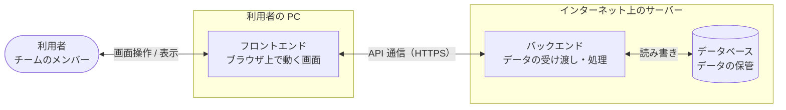

# 問い合わせ管理アプリ 要件定義書

## 1. 文書情報

| 項目 | 内容 |
| --- | --- |
| 文書名 | 問い合わせ管理アプリ 要件定義書 |
| 版数 | 1.1 |
| 作成日 | 2026-10-31 |
| 最終更新日 | 2026-10-31 |
| 作成者 | KeiT0773 |
| ステータス | 作成中（レビュー待ち） |
| 関連文書 | [機能要件書](functional-requirements.md)、[画面要件書](screen-requirements.md)（作成予定）、[データ要件書](data-requirements.md)（作成予定）、画面モック（[mock/index.html](../mock/index.html)） |

本書は、本システムの背景・目的・スコープ・全体方針を定める上位文書である。機能・画面・データの詳細要件は、上記の関連文書にそれぞれ定義する（「6. 詳細要件」参照）。

本システムは、先行プロジェクトのタスク管理アプリ（`KeiT0773/TASKMANAGEMENT`。以下「タスク管理アプリ」）と同じカンバンボードの構造を持つ。本書の構成と、システム構成・非機能要件の多くはタスク管理アプリの要件定義書（2.5 版）を踏襲し、異なる点は「10. 決定事項」に明記する。

### 1.1 変更履歴

| 版数 | 日付 | 変更内容 | 変更者 |
| --- | --- | --- | --- |
| 1.0 | 2026-10-31 | 初版作成。画面モックで確認した仕様（決定事項 No.10〜18）を反映 | KeiT0773 |
| 1.1 | 2026-10-31 | 機能要件書の作成に伴い、機能要件書への参照から「作成予定」を削除 | KeiT0773 |

---

## 2. プロジェクト概要

### 2.1 背景・目的

チームに寄せられる問い合わせ（質問・不具合の報告・要望など）を、メールの受信箱や表計算ソフトではなく「対応の進み具合がひと目で分かる形」で管理したい。カンバン方式は、問い合わせを「未対応 / 対応中 / 完了」の列に並べることで、どの問い合わせが手付かずで、どれが対応中かを一覧で把握できる。本プロジェクトでは、その仕組みを少人数のチーム向けに最小限の機能で実装する。

あわせて、Web アプリケーション開発の一連の流れ（要件定義 → 設計 → 実装）を実践的に学ぶことも本プロジェクトの目的とする。

### 2.2 現状の課題と解決方針

現在は問い合わせをメールや表計算ソフトで個別に管理しているが、以下の課題がある。本システムでは、それぞれの課題を次の機能で解決する。機能 ID（FR-xx）と画面 ID（SC-xx）の定義は「6. 詳細要件」を参照。

| No | 現状の課題 | 本システムでの解決方針 | 関連機能 |
| --- | --- | --- | --- |
| 1 | 問い合わせが「まだ誰も手を付けていないのか」「対応中なのか」「回答済みなのか」を一覧で把握できず、対応漏れが起きる | ステータスごとの3つの列に問い合わせを並べ、ボード全体を見るだけで対応状況が分かるようにする | SC-01, FR-04 |
| 2 | ステータスが変わるたびに、表を書き直したり行を移動したりする手間がかかる | 問い合わせをドラッグ&ドロップで列の間を移動させるだけで、ステータスを変えられるようにする | FR-04, FR-05 |
| 3 | 誰がどの問い合わせを担当しているのかが分からず、二重対応や放置が起きる | 問い合わせごとに対応者を記録し、対応者が決まっていないものを目立たせる | FR-06 |
| 4 | どの問い合わせから対応すべきかが、内容を読み返さないと判断できない | 問い合わせに優先度と対応期限を表示し、一覧を見ただけで対応順を判断できるようにする。ボタン 1 つで全列を優先度順に並べ直せるようにする | FR-07, FR-08, FR-10 |
| 5 | 対応期限を過ぎた問い合わせがあっても気付きにくい | 対応期限を過ぎた未完了の問い合わせを他と区別して表示し、見落としを防ぐ | FR-07 |
| 6 | 問い合わせ者・連絡先・内容・回答の経過が別々の場所に散らばり、探すのに時間がかかる | 問い合わせごとに問い合わせ者・連絡先・種別・内容・対応メモを持たせ、1 か所にまとめる | FR-01, FR-02 |
| 7 | 記録がメンバーの手元にあり、他のメンバーが同じ情報を見られない | 操作のたびにサーバー上のデータベースへ自動保存し、チームの誰がどの端末で開いても同じボードを見られるようにする | FR-09 |

### 2.3 システムの概要

ブラウザ上で動作する、少人数のチームで共有するカンバン方式の問い合わせ管理アプリケーション。利用者は受け付けた問い合わせを「カード」として登録し、ドラッグ&ドロップで列の間を移動させることで対応状況（ステータス）を管理する。登録したデータはインターネット上のサーバーにあるデータベースに保存され、ページを閉じても失われない。チームのメンバーは、同じ URL にアクセスすれば同じデータを参照・操作できる。

### 2.4 システム構成

本システムは、タスク管理アプリと同じく、役割の異なる3つの層で構成する（3層構成）。

| 層 | 役割 | 動作する場所 |
| --- | --- | --- |
| フロントエンド | 利用者が操作する画面。問い合わせの表示、ドラッグ&ドロップ、入力の受け付けを担当し、操作内容をバックエンドに送る | 利用者の PC のブラウザ |
| バックエンド | フロントエンドからの要求（取得・登録・更新・削除）を受け取り、内容を検証したうえでデータベースを読み書きし、結果を返す | インターネット上のサーバー |
| データベース | 問い合わせとステータスのデータを永続的に保管する。利用者やフロントエンドから直接は触れず、必ずバックエンドを経由する | インターネット上のサーバー |

- フロントエンドとバックエンドの間の通信は、インターネットを経由するため暗号化（HTTPS）する。
- 各層で使用する技術（プログラミング言語、フレームワーク、データベース製品）とサーバーの具体的な配置先は基本設計で決定する。タスク管理アプリと同じ構成を第一候補とする。
- 利用者の操作に伴って3層の間でデータがどう流れるかは、[データ要件書](data-requirements.md)（作成予定）に示す。

---

## 3. 用語定義

| 用語 | 定義 |
| --- | --- |
| ボード | アプリ全体の作業領域。3つのリストを横に並べて表示する画面そのものを指す。 |
| リスト（列） | ボード上に縦方向に並ぶ問い合わせの入れ物。本システムでは「未対応」「対応中」「完了」の3つを指し、それぞれが問い合わせのステータスを表す。 |
| ステータス | 問い合わせの対応状況。「未対応」「対応中」「完了」の3つ。問い合わせがどのリストにあるかで決まる。 |
| 問い合わせ（カード） | 1件の問い合わせを表す単位。リストの中に縦に積み重なって表示される。画面上の表示単位を指すときは「カード」とも呼ぶ。 |
| 件名 | 問い合わせの内容をひと言で表す見出し。 |
| 問い合わせ者 | 問い合わせをしてきた人の名前。 |
| 連絡先 | 問い合わせ者に回答するためのメールアドレスまたは電話番号。 |
| 種別 | 問い合わせの分類。「質問」「不具合」「要望」「その他」の4つ。 |
| 問い合わせ内容 | 問い合わせ者から寄せられた内容の本文。 |
| 対応メモ | 回答した内容や対応の経過を、チームの中で残すための記録。 |
| 対応者 | その問い合わせを担当するチームのメンバー。決まっていない状態を「未割当」と呼ぶ。 |
| 受付日 | 問い合わせをシステムに登録した日付。 |
| 対応期限 | その問い合わせへの対応を完了させるべき日付。 |
| 優先度 | その問い合わせにどれだけ早く対応すべきかを示す区分。「高」「中」「低」の3つ。 |
| フロントエンド | 利用者のブラウザ上で動作する画面側のプログラム。 |
| バックエンド | サーバー上で動作し、フロントエンドからの要求を受けてデータベースを読み書きするプログラム。 |
| データベース（DB） | サーバー上でデータを永続的に保管する仕組み。 |
| API | フロントエンドとバックエンドがデータをやり取りするための取り決め（窓口）。 |

---

## 4. スコープ

### 4.1 対象範囲

本システムで実装するのは以下の3つとする。それぞれの詳細は「6. 詳細要件」に示す各文書に定義する。

- **フロントエンド**：単一のボードにおける問い合わせの登録・編集・ステータス変更を行う画面
- **バックエンド**：フロントエンドからの要求を受けて問い合わせのデータを取得・登録・更新・削除する API
- **データベース**：問い合わせとステータスのデータを保管する仕組み

### 4.2 対象外

以下は本バージョンでは実装しない。将来的な拡張候補として「9. 今後の拡張候補」に記載する。

- 利用者ごとのログイン機能、および利用者の管理（メンバーの登録・権限の設定）
- 他のメンバーの操作をその場で画面に反映する機能（リアルタイムの同期）
- 問い合わせ者へのメール送信など、システムから外部への連絡
- メールやフォームからの問い合わせの自動取り込み
- リスト（ステータス）自体の追加・削除・名称変更
- 複数ボードの作成・切り替え
- 完了した問い合わせの保管（アーカイブ）や、キーワードによる検索・絞り込み
- サーバーの監視・自動復旧などの運用機能

---

## 5. 想定利用者・利用シーン

### 5.1 想定利用者

| 項目 | 内容 |
| --- | --- |
| 想定利用者 | 少人数のチーム（数名、最大5名程度）。チームに寄せられる問い合わせを、メンバーで分担して対応する。 |
| 想定端末 | Windows 11 の PC。デスクトップブラウザでの利用を前提とする。 |
| 利用環境 | インターネットに接続でき、かつアクセスを許可したネットワーク（7. 非機能要件「アクセス制御」）につながった環境。サーバーと通信するため、接続がない状態では利用できない。 |
| 利用シーン | 問い合わせを受け付けたメンバーが「未対応」に登録し、対応者を決めて「対応中」へ、回答を終えたら「完了」へ移しながら、チームで対応状況を共有する。 |
| 想定データ量 | 1ボードあたり最大300件程度の問い合わせ（完了したものを含む）。 |
| 同時利用 | 複数のメンバーが同時にボードを開き、操作することがある。他のメンバーの操作は、画面を開き直す（再読み込みする）と反映される。同じ問い合わせを同時に編集した場合の扱いは「10. 決定事項」No.17 に定める。 |

### 5.2 利用シナリオ

チームの1日の使い方を、画面と機能に対応させて示す。

| 時点 | 利用者の行動 | システムの動き | 画面 | 関連機能 |
| --- | --- | --- | --- | --- |
| 朝・始業時 | ブラウザでアプリの URL を開く | サーバーから最新のデータを取得し、前日までのボードをそのまま表示する | SC-01 | FR-09 |
| 〃 | 「未対応」列を見て、対応者が「未割当」（赤字）の問い合わせを確認する | 対応者が決まっていない問い合わせが赤字で目立って表示されている | SC-01 | FR-06 |
| 〃 | 自分が担当する問い合わせを開き、対応者に自分の名前を入れる | カード表面に対応者の名前が表示され、サーバーに保存される | SC-02 | FR-06, FR-09 |
| 日中 | 電話やメールで受けた問い合わせを「未対応」列に登録する。件名・問い合わせ者・問い合わせ内容を入力し、種別と優先度を選ぶ | 問い合わせが「未対応」列の優先度順の位置に追加され、受付日に当日の日付が入る。必須項目が空のときは登録されず、足りない項目が示される | SC-01 | FR-01 |
| 〃 | 締切のある問い合わせを開き、連絡先と対応期限を入れる | カード表面に対応期限が表示される | SC-02 | FR-02, FR-07 |
| 〃 | 「優先度順に並べ替え」を押して、3 つの列を優先度の高い順にそろえる | 3 つの列それぞれで、優先度の高い問い合わせが上に来る。同じ優先度の中の順序は変わらない | SC-01 | FR-10 |
| 〃 | 対応を始めた問い合わせを「対応中」列へドラッグする | 問い合わせが「対応中」列に移り、その状態がサーバーに保存される | SC-01 | FR-04, FR-09 |
| 〃 | 調べた内容や回答の経過を対応メモに書き留める | 対応メモがサーバーに保存され、他のメンバーが開いたときにも表示される | SC-02 | FR-02, FR-09 |
| 〃 | 回答を終えた問い合わせを「完了」列へドラッグする | 問い合わせが「完了」列に移り、その状態がサーバーに保存される | SC-01 | FR-04, FR-09 |
| 〃 | 他のメンバーの対応状況を見るために、画面を再読み込みする | 他のメンバーが登録・変更した内容を含む最新のボードが表示される | SC-01 | FR-09 |
| 夕方・終業時 | 「未対応」「対応中」列で、対応期限を過ぎて強調表示されている問い合わせを確認し、翌日の優先度や対応者を見直す | 対応期限を過ぎた未完了の問い合わせが他と区別して表示されている | SC-01, SC-02 | FR-06, FR-07, FR-08 |
| 〃 | 誤って登録した問い合わせを削除する | 確認ダイアログが表示され、OK を押すと問い合わせが消えて、その状態がサーバーに保存される | SC-02 | FR-03, FR-09 |

---

## 6. 詳細要件

機能・画面・データに関する詳細要件は、以下の3文書に分けて定義する（画面要件書・データ要件書は作成予定）。本書はその概要のみを示し、詳細は各文書の記載を正とする。各文書の作成までは、画面モック（[mock/](../mock/)）の動きを参考とする。

| 文書 | 内容 | 定義する ID |
| --- | --- | --- |
| [機能要件書](functional-requirements.md) | 本システムが提供する機能の一覧と、機能ごとの詳細な振る舞い | FR-01〜FR-10 |
| [画面要件書](screen-requirements.md) | 画面の一覧、画面構成の要件、画面遷移、画面イメージ | SC-01, SC-02 |
| [データ要件書](data-requirements.md) | データベースに保持する情報の項目定義、ER図、データフロー図 | ― |

### 6.1 機能の概要

利用者が問い合わせに対して行う操作（登録・編集・削除・ステータス変更・並べ替え）、問い合わせに付ける情報（対応者・対応期限・優先度）、サーバーへのデータ保存、および全リストの優先度順並べ替えの10機能で構成する。すべて必須機能とする。

| ID | 機能名 | 概要 |
| --- | --- | --- |
| FR-01 | 問い合わせ登録 | 「未対応」列にだけ登録できる。件名・問い合わせ者・問い合わせ内容は必須。種別（初期値「質問」）と優先度（初期値「中」）を選べる。受付日は登録日が自動で入る |
| FR-02 | 問い合わせ編集 | 件名・問い合わせ者・連絡先・種別・問い合わせ内容・対応メモを変更する。必須項目（件名・問い合わせ者・問い合わせ内容）を空にはできない |
| FR-03 | 問い合わせ削除 | 確認ダイアログで OK を押したときだけ削除する |
| FR-04 | ステータス変更 | ドラッグ&ドロップで別の列へ移す、または問い合わせ詳細でステータスを選んで変える |
| FR-05 | 問い合わせの並べ替え | ドラッグ&ドロップで同じ列の中の順序を入れ替える |
| FR-06 | 対応者の設定 | 対応者の名前を自由入力で設定する。未割当のときはカード表面に赤字で「未割当」と表示する |
| FR-07 | 対応期限の設定 | 対応期限（日付）を設定・解除する。期限を過ぎた未完了の問い合わせを目立たせる |
| FR-08 | 優先度の設定 | 優先度を「高 / 中 / 低」から選ぶ。色で見分けられるように表示する |
| FR-09 | データ保存 | 操作のたびにサーバーのデータベースへ保存し、どの端末・どのメンバーからも同じ状態を見られるようにする |
| FR-10 | 全リストの優先度順並べ替え | ボタン 1 つで3つの列すべてを優先度順（高→中→低）に並べ直す |

各機能の詳細な振る舞いは[機能要件書](functional-requirements.md)に定める。

### 6.2 画面の概要

画面は、3つのリストと問い合わせを一覧するメイン画面（SC-01 ボード画面）と、1件の問い合わせの内容を編集する画面（SC-02 問い合わせ詳細）の2つのみとする。問い合わせ詳細はボード画面の手前に重ねて表示し、別ページへは遷移しない。

カード表面には、件名・優先度・問い合わせ者・対応者・種別・対応期限を表示する。問い合わせ内容・連絡先・対応メモ・受付日は、問い合わせ詳細でだけ表示する。

画面構成の要件と画面イメージは[画面要件書](screen-requirements.md)（作成予定）に定める。画面イメージは画面モック（[mock/index.html](../mock/index.html)）を参照。

### 6.3 データの概要

データベースには「リスト（ステータス）」と「問い合わせ」の2種類の情報を保持する。リストは「未対応 / 対応中 / 完了」の3件で固定とする。問い合わせは1件ごとに、次の項目を持つ。

| 項目 | 必須 | 備考 |
| --- | --- | --- |
| 件名 | ○ | 最大100文字 |
| 問い合わせ者 | ○ | 最大50文字 |
| 連絡先 | | 最大100文字。メールアドレスまたは電話番号（形式は問わない） |
| 種別 | ○ | 質問 / 不具合 / 要望 / その他 |
| 問い合わせ内容 | ○ | 複数行 |
| 対応メモ | | 複数行 |
| 対応者 | | 最大50文字。自由入力。空のときは未割当 |
| 受付日 | ○ | 登録日が自動で入る。変更はできない |
| 対応期限 | | 日付 |
| 優先度 | ○ | 高 / 中 / 低 |
| 所属リスト（ステータス） | ○ | 未対応 / 対応中 / 完了 |
| 表示順 | ○ | リストの中での並び順 |

文字数の上限は画面モックの値であり、確定値は[データ要件書](data-requirements.md)（作成予定）に定める。項目の定義、ER図、データフロー図も同書に定める。

---

## 7. 非機能要件

タスク管理アプリの非機能要件を踏襲する。チームで利用することに伴い、「同時利用」を追加し、「性能」「データ保管」の想定件数を変更している。

| 分類 | 要件 |
| --- | --- |
| 対応ブラウザ | Google Chrome および Microsoft Edge の最新版で正しく動作すること。 |
| 対応環境 | Windows 11 のデスクトップ環境。スマートフォン対応は本バージョンでは必須としない。 |
| 性能 | 問い合わせ300件程度を表示した状態でも、ドラッグ操作が引っかかりなく行えること。操作結果がサーバーに保存されるまでの待ち時間が、利用者の操作を妨げないこと。 |
| 操作性 | 主要な操作（問い合わせの登録・ステータス変更）は、説明を読まずに直感的に行えること。 |
| 同時利用 | 最大5名程度のメンバーが同時に操作しても、データが壊れないこと（一方の操作が他方の無関係な問い合わせの内容を消すなど）。他のメンバーの操作は、画面を開き直すと反映されること。 |
| データ保管 | データはサーバー上のデータベースに保管し、利用者の端末やブラウザには依存しないこと。想定データ量（問い合わせ300件程度）を問題なく保管できること。 |
| 可用性 | サーバーが稼働している間は、アクセスを許可したネットワーク（「アクセス制御」）からいつでも利用できること。ネットワーク未接続やサーバー停止中は利用できないが、その状態を利用者に通知すること（FR-09）。 |
| 通信の保護 | フロントエンドとバックエンドの間の通信は HTTPS で暗号化し、通信経路上で内容を盗み見られないこと。 |
| アクセス制御 | 本システムには、**利用者の自宅のネットワークからだけ**アクセスできること。それ以外の場所からの要求（画面・API とも）は拒否する。判定はアクセス元の IP アドレス（IPv6 のネットワーク番号）で行う。ログイン機能などの認証は設けない。具体的な方式はインフラ設計書（作成予定）に定める。 |
| データ保護 | サーバー側のデータベースは、インターネットから直接アクセスできない構成とし、必ずバックエンドを経由すること。問い合わせ者の氏名・連絡先（個人情報）を保管するため、「アクセス制御」「通信の保護」を必ず満たすこと。 |
| 費用 | サーバーの利用料を可能な限り抑えること。サーバー側の各リソース（データベース、バックエンドの実行環境など）は、クラウドの無料利用枠の対象と同じ規模（データベースは最小クラス・ストレージ 20 GB・冗長化なし、など）を上限とし、それより大きな構成にしない。使わない期間は、サーバーを撤去して利用料がほぼかからない状態にできること。具体的な上限と費用の見積もりはインフラ設計書（作成予定）に定める。 |

---

## 8. 制約事項

- インターネットに接続していない環境では利用できない。
- サーバーが停止している間は利用できない。サーバーの監視や自動復旧は本バージョンの対象外とする（4.2）。
- アクセスを許可したネットワーク以外（外出先、職場、スマートフォンのモバイル回線など）からは利用できない（7. 非機能要件「アクセス制御」）。チームのメンバーも、許可したネットワークにつながった端末からしか利用できない。
- 認証機能がないため、許可したネットワークにつながった端末からは、誰でもデータを閲覧・変更できる。操作した人（誰が登録・変更したか）は記録しない。
- IPv6 で通信できない状態（ルーターの不調など）では利用できない。許可したネットワークの番号が変わった場合は、許可するネットワークを更新するまで利用できない。
- 他のメンバーの操作は自動では画面に反映されない。最新の状態を見るには画面を開き直す必要がある（決定事項 No.17）。
- サーバーの利用料の見積もりはインフラ設計書（作成予定）に記載する。本システムで使う AWS アカウントは無料利用枠の期間を過ぎているため、無料利用枠と同じ規模のリソース（7.「費用」）でも利用料がかかる。独自ドメインは取得しない。
- バックアップ機能およびデータの書き出し機能は本バージョンでは提供しない。
- 問い合わせの削除は確認ダイアログを経て確定し、確定後の取り消し（アンドゥ）はできない（FR-03）。

---

## 9. 今後の拡張候補

本バージョンでは実装しないが、将来的に検討しうる機能を以下に挙げる。

| 分類 | 機能 |
| --- | --- |
| 利用者 | ログイン機能、メンバーの登録と対応者の選択式化、操作した人の記録（履歴） |
| 共同利用 | 他のメンバーの操作のリアルタイム反映、同じ問い合わせを同時に編集したときの警告 |
| 問い合わせ | 対応メモの時系列の記録（コメント形式）、ファイル添付、問い合わせ者ごとの履歴表示 |
| 外部連携 | メール・フォームからの問い合わせの自動取り込み、問い合わせ者への回答メールの送信 |
| 全体機能 | キーワード検索、対応者・種別・期限での絞り込み、完了した問い合わせのアーカイブ |
| リスト操作 | ステータス（列）の追加・名称変更・削除 |
| 集計 | 期間ごとの件数・対応にかかった日数の集計 |
| データ | バックアップ、CSV などへの書き出し |
| 運用 | サーバーの監視、障害時の自動復旧 |

---

## 10. 決定事項

要件の検討と画面モックでの確認を経て決めた事項を以下に記録する。「関連」欄の章番号は本書のもの、FR-xx は「6.1 機能の概要」（詳細は機能要件書）を指す。「タスク管理アプリとの違い」欄は、タスク管理アプリの同じ事項から変えたものを示す。

| No | 決定内容 | 関連 | タスク管理アプリとの違い | 決定日 |
| --- | --- | --- | --- | --- |
| 1 | リスト（ステータス）は「未対応 / 対応中 / 完了」の3つで固定とし、利用者による増減は行わない | 4.2, 6.3 | 名称が異なる（未着手 / 作業中 / 完了） | 2026-10-31 |
| 2 | 優先度は「高 / 中 / 低」の3段階とする | FR-08 | 同じ | 2026-10-31 |
| 3 | 対応期限を過ぎた問い合わせは、表示を変えて目立たせる。ただし「完了」列にあるものは対象外とする | FR-07 | 同じ | 2026-10-31 |
| 4 | 問い合わせの削除時は確認ダイアログを表示し、OK を押したときだけ削除する。問い合わせは記録としての性格が強く、誤操作による消失を防ぐことを手数より優先する | FR-03 | **異なる**（タスク管理アプリは確認なし） | 2026-10-31 |
| 5 | スマートフォンでの利用は本バージョンでは考慮しない | 7 | 同じ | 2026-10-31 |
| 6 | 扱うボードは1つとし、複数ボードの切り替えは行わない | 4.2 | 同じ | 2026-10-31 |
| 7 | システムはフロントエンド・バックエンド・データベースの3層構成とし、データはサーバー上のデータベースに保存する | 2.4, FR-09 | 同じ | 2026-10-31 |
| 8 | バックエンドとデータベースはインターネット上のサーバーに配置する。具体的な配置先は基本設計で決める（タスク管理アプリと同じ構成を第一候補とする） | 2.4 | 同じ | 2026-10-31 |
| 9 | 利用者は少人数のチーム（最大5名程度）とする。ログイン機能は設けず、アクセスできるネットワークを限ることで第三者からのアクセスを防ぐ | 5.1, 7, 8 | **異なる**（タスク管理アプリは個人1名） | 2026-10-31 |
| 10 | 問い合わせは「未対応」列にだけ登録できる。新しい問い合わせは必ず未対応から始まるため、「対応中」「完了」列には登録の操作を置かない | FR-01 | **異なる**（タスク管理アプリは全列で登録可） | 2026-10-31 |
| 11 | 登録時は件名・問い合わせ者・問い合わせ内容を必須とする。空欄（空白だけの入力を含む）があるときは登録せず、足りない項目を利用者に示す。登録後の編集でも、これらを空にはできない | FR-01, FR-02 | **異なる**（タスク管理アプリの必須はタイトルだけ） | 2026-10-31 |
| 12 | 対応者を問い合わせごとに設定できる。入力は自由入力とし、メンバーの一覧からの選択にはしない。対応者が未割当のときは、カード表面に赤字で「未割当」と表示する | FR-06 | 新規 | 2026-10-31 |
| 13 | 問い合わせの登録時に種別（初期値「質問」）と優先度（初期値「中」）を選べるようにする。対応者・連絡先・対応期限・対応メモは登録後に問い合わせ詳細で設定する | FR-01 | 優先度は同じ。種別は新規 | 2026-10-31 |
| 14 | 受付日は登録した日付を自動で設定し、利用者は変更できない | FR-01, 6.3 | 新規 | 2026-10-31 |
| 15 | 問い合わせの登録後および優先度の変更後は、そのリスト内を優先度順（高→中→低）に並べ直す。同じ優先度の中では既存の順序を保ち、操作した問い合わせは末尾に置く。ドラッグによる並べ替え・移動では自動の並べ替えは行わない | FR-01, FR-05, FR-08 | 同じ | 2026-10-31 |
| 16 | すべてのリストを一括で優先度順（高→中→低）に並べ直すボタンを、リストの枠の外（ヘッダーとリストの間）に 1 つ置く。同じ優先度の中では既存の順序を保つ。操作前の確認は求めず、元に戻す手段は提供しない | FR-10 | 同じ | 2026-10-31 |
| 17 | 他のメンバーの操作は、画面を開き直したときに反映する（リアルタイムの同期はしない）。同じ問い合わせを複数のメンバーが同時に編集した場合は、後から保存した内容で上書きする。他のメンバーが削除した問い合わせを操作した場合は、操作が保存できなかったことを利用者に通知する | 5.1, 7, FR-09 | 新規 | 2026-10-31 |
| 18 | 問い合わせ詳細でもステータスを変更できる。変更した問い合わせは、変更先の列の末尾に置く | FR-04 | 新規 | 2026-10-31 |
| 19 | サーバー側のリソースは、無料利用枠の対象と同じ規模を上限とし、利用料を可能な限り抑える。無料利用枠の期間は過ぎているため利用料はかかるが、性能より費用を優先する | 7, 8 | 同じ | 2026-10-31 |
| 20 | アクセスできる場所を、インターネットのどこからでもではなく、利用者の自宅のネットワーク（IPv6 のネットワーク番号）からだけに限る。IPv4 は他の契約者と共有されていることがあるため、判定に使わず拒否する | 7, 8 | 同じ | 2026-10-31 |

---

## 11. 受け入れ基準

本システムが要件を満たしているかを判断する基準を以下に定める。すべての項目が合格条件を満たした時点で、本システムは完成とみなす。確認は「7. 非機能要件」に定めた対応ブラウザで行う。各項目の「対象」に示す FR-xx・SC-xx は「6. 詳細要件」の定義に対応する。

### 11.1 機能要件

| 対象 | 確認方法 | 合格条件 |
| --- | --- | --- |
| FR-01 | ボード画面を開く | 登録の操作は「未対応」列にだけあり、「対応中」「完了」列には無い |
| FR-01 | 件名・問い合わせ者・問い合わせ内容を入力し、種別と優先度は変えずに登録する | 問い合わせが「未対応」列に追加され、種別が「質問」、優先度が「中」、対応者が未割当、受付日が当日になっている。表示位置は「中」の問い合わせの末尾 |
| FR-01 | 優先度に「高」を選んで登録する | 問い合わせが優先度「高」で追加され、「高」の問い合わせの末尾（「中」「低」より上）に表示される |
| FR-01 | 件名・問い合わせ者・問い合わせ内容のいずれか（または全部）を空のまま、または空白だけを入力して登録操作を行う | 問い合わせが追加されない。空の項目が利用者に分かるように示される |
| FR-02 | 既存の問い合わせの件名・問い合わせ者・連絡先・種別・問い合わせ内容・対応メモを変更する | 変更が即座にボード画面に反映される。ページを再読み込みしても変更後の内容が表示される |
| FR-02 | 問い合わせ詳細で件名・問い合わせ者・問い合わせ内容のいずれかを空にする | 空の内容は保存されず、ページを再読み込みすると変更前の内容が表示される |
| FR-02 | 問い合わせ詳細で複数行の問い合わせ内容と対応メモを入力し、閉じてから再度開く | 入力した内容が改行を保ったまま表示される。ボード画面のカード表面には問い合わせ内容・対応メモが表示されない |
| FR-03 | 問い合わせ詳細で削除を押し、確認ダイアログでキャンセルを選ぶ | 問い合わせは削除されずに残る |
| FR-03 | 問い合わせ詳細で削除を押し、確認ダイアログで OK を選ぶ | 問い合わせが消える。ページを再読み込みしても復活しない |
| FR-04 | 問い合わせを「未対応」列から「対応中」列へドラッグ&ドロップする | ドラッグ中に挿入位置が視覚的に示される。ドロップ後、問い合わせが「対応中」列に表示される。ページを再読み込みしても「対応中」列にある |
| FR-04 | 問い合わせ詳細でステータスを「完了」に変える | 問い合わせが「完了」列の末尾に移る。ページを再読み込みしても「完了」列にある |
| FR-05 | 同じ列の中で問い合わせを上下にドラッグして順序を入れ替える | 表示順が入れ替わる。ページを再読み込みしても入れ替え後の順序が維持される |
| FR-05 | 「低」の問い合わせを「高」の問い合わせより上にドラッグしてから、新しい問い合わせを登録する | ドラッグで整えた順序は、登録した問い合わせの位置を除いてそのまま維持される |
| FR-06 | 対応者が空の問い合わせを表示する | カード表面に「未割当」が赤字で表示される |
| FR-06 | 問い合わせ詳細で対応者に名前を入力する | カード表面に対応者の名前が通常の色で表示される。ページを再読み込みしても維持される |
| FR-07 | 問い合わせに対応期限を設定する | カード表面に対応期限が表示される |
| FR-07 | 対応期限を過ぎた問い合わせを「未対応」「対応中」「完了」の各列に置く | 「未対応」「対応中」列のものは他と見分けられる表示になり、「完了」列のものは通常の表示になる（判定基準は基本設計で定める） |
| FR-07 | 対応期限を設定しない問い合わせを表示する | エラーにならず、対応期限の表示が空欄になっている |
| FR-08 | 優先度「高」「中」「低」の問い合わせを1件ずつ作り、並べて表示する | 3件の問い合わせが、色によって互いに見分けられる |
| FR-08 | 「低」の問い合わせの詳細を開き、優先度を「高」に変更する | その問い合わせが同じ列の「高」の問い合わせの末尾に移動している。ページを再読み込みしても位置が維持される |
| FR-09 | 問い合わせの登録・編集・ステータス変更・削除を行った後、ブラウザを完全に閉じてから再度アプリを開く | 閉じる直前と同じ状態（問い合わせの内容・所属列・順序）が表示される |
| FR-09 | メンバー A の PC で問い合わせを登録した後、メンバー B の PC で同じ URL を開く（または再読み込みする） | メンバー A が登録した問い合わせが表示される |
| FR-09 | メンバー A が削除した問い合わせを、削除前から画面を開いていたメンバー B が編集する | 編集が保存できなかったことが、メンバー B の画面上で通知される |
| FR-09 | ネットワークを切断した状態で問い合わせを操作する | 操作が保存されなかったことが画面上で利用者に通知される |
| FR-10 | 3 つの列それぞれで「低」の問い合わせを「高」の問い合わせより上にドラッグしてから、「優先度順に並べ替え」を押す | 3 つの列すべてが高→中→低の順になる。同じ優先度の問い合わせどうしの順序は押す前と同じ。ページを再読み込みしても維持される |
| FR-10 | すべての問い合わせが同じ優先度の列で「優先度順に並べ替え」を押す | その列の順序は変わらない |

### 11.2 画面要件

| 対象 | 確認方法 | 合格条件 |
| --- | --- | --- |
| SC-01 | 想定端末のブラウザでボード画面を開く | 「未対応」「対応中」「完了」の3列が横に並び、横スクロールなしで同時に見える。各列に件数が表示される |
| SC-01 | 問い合わせを表示する | 詳細を開かなくても、カード表面で件名・優先度・問い合わせ者・対応者・種別・対応期限が読み取れる |
| SC-02 | ボード画面から問い合わせ詳細を開く | ボード画面が背後に残ったまま、問い合わせ詳細が手前に表示される。受付日が表示される。閉じるとボード画面に戻り、別ページへは遷移しない |

### 11.3 非機能要件

| 対象 | 確認方法 | 合格条件 |
| --- | --- | --- |
| 性能 | 問い合わせを300件登録した状態で、問い合わせをドラッグする | ドラッグ中の問い合わせがマウスの動きに追従し、ドロップ後1秒以内に配置が確定する |
| 性能 | 問い合わせを300件登録した状態で、アプリを開く | 3秒以内にボード画面にすべての問い合わせが表示される |
| 操作性 | 本システムの説明を受けていない人に、口頭の案内なしで「問い合わせを1件登録し、対応中へ移動する」操作を依頼する | 3分以内に操作を完了できる |
| 同時利用 | 2台の PC で同時にボードを開き、それぞれ別の問い合わせを編集・移動してから、両方の画面を再読み込みする | 両方の操作が反映されており、どちらの変更も失われていない |
| データ保管 | 問い合わせを300件登録し、各問い合わせに問い合わせ内容と対応メモを入力する | 保存に失敗せず、再読み込み後もすべての問い合わせが復元される |
| 可用性 | サーバーが稼働している状態で、時間帯を変えて複数回アプリを開く | いずれの回もボード画面が表示され、操作できる |
| 可用性 | サーバーを停止した状態でアプリを開く、または問い合わせを操作する | サーバーと通信できないことが画面上で利用者に通知される |
| 通信の保護 | ブラウザのアドレスバーと開発者ツールで、フロントエンドとバックエンドの間の通信を観察する | すべての通信が HTTPS で行われている |
| データ保護 | インターネット上からデータベースへ直接接続を試みる | 接続できない |
| アクセス制御 | 許可したネットワークの端末と、それ以外の場所（モバイル回線など）の端末から、それぞれアプリを開く | 許可したネットワークからは表示・操作でき、それ以外からは拒否される（画面も API も） |
