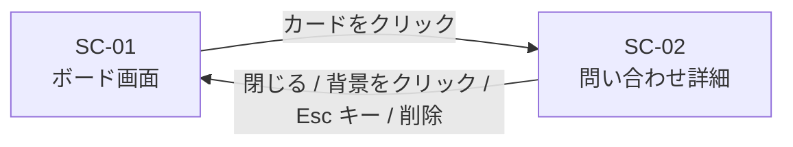

# 問い合わせ管理アプリ 画面要件書

## 1. 文書情報

| 項目 | 内容 |
| --- | --- |
| 文書名 | 問い合わせ管理アプリ 画面要件書 |
| 版数 | 1.1 |
| 作成日 | 2026-10-31 |
| 最終更新日 | 2026-10-31 |
| 作成者 | KeiT0773 |
| ステータス | 作成中（レビュー待ち） |
| 上位文書 | [要件定義書](requirements.md) |
| 関連文書 | [機能要件書](functional-requirements.md)、[データ要件書](data-requirements.md)、画面モック（[mock/index.html](../mock/index.html)） |

本書は、本システムが持つ画面と、その構成・遷移・表示項目を定義する。各画面で操作する機能（FR-xx）の内容は [機能要件書](functional-requirements.md) を参照すること。本書中の「決定事項 No.xx」は要件定義書「10. 決定事項」を指す。

### 1.1 変更履歴

| 版数 | 日付 | 変更内容 | 変更者 |
| --- | --- | --- | --- |
| 1.0 | 2026-10-31 | 初版作成。要件定義書 1.0 版の「6.2 画面の概要」と画面モックをもとに、SC-01・SC-02 の構成・遷移・画面イメージを定義。機能要件書 3.1 の変更（同じ優先度の中は対応期限の近い順）を 5.1・5.2 の説明に反映 | KeiT0773 |
| 1.1 | 2026-10-31 | データ要件書の作成に伴い、データ要件書への参照から「作成予定」を削除 | KeiT0773 |

---

## 2. 画面一覧

| ID | 画面名 | 役割 |
| --- | --- | --- |
| SC-01 | ボード画面 | メイン画面。3つのリストと問い合わせを一覧表示し、問い合わせの登録・ステータス変更・並べ替え、全リストの優先度順並べ替えを行う |
| SC-02 | 問い合わせ詳細 | 1件の問い合わせの全項目を確認・編集し、削除する。ボード画面から呼び出す |

---

## 3. 画面構成の要件

- ボード画面では「未対応」「対応中」「完了」の3つのリストを横に並べて表示し、横にスクロールせずに同時に見渡せること。各リストの見出しには、そのリストにある問い合わせの件数を表示すること。
- 3つのリストは、見出しの色などでステータスの違いが分かるようにすること。
- 各リストの中では、問い合わせを表示順に従って縦に並べること。問い合わせが多いときは、リストの中だけをスクロールできること（ボード画面全体はスクロールさせない）。
- カードの表面には、詳細を開かなくても次の項目が読み取れること。問い合わせ内容・連絡先・対応メモ・受付日は問い合わせ詳細でのみ表示する。

  | 項目 | 表示のしかた |
  | --- | --- |
  | 件名 | そのまま表示する |
  | 優先度 | 色付きの表示（FR-08） |
  | 問い合わせ者 | 名前の後ろに「様」を付けて表示する |
  | 対応者 | 名前を表示する。未割当のときは「未割当」を赤字で表示する（FR-06） |
  | 種別 | 種別ごとに色を変えたラベルで表示する |
  | 対応期限 | 「期限 MM/DD」の形で表示する。未設定なら空欄。期限を過ぎた未完了の問い合わせは、他と区別できる表示にする（FR-07） |

- 問い合わせを登録する操作は「未対応」リストにだけ配置すること。「対応中」「完了」リストには置かない（決定事項 No.10）。登録時には件名・問い合わせ者・問い合わせ内容・種別・優先度を入力できること。
- すべてのリストの問い合わせを優先度順に並べ直す操作を、リストの枠の外（ヘッダーとリストの間のツールバー）に 1 つ配置すること。全リスト共通の操作であることが分かるようにする。
- 問い合わせ詳細は、ボード画面の表示を保ったまま開閉できること（別ページへは遷移しない）。
- 問い合わせを削除する操作は、誤操作を防ぐためボード画面のカード表面には置かず、問い合わせ詳細の下部に配置すること。

---

## 4. 画面遷移

ボード画面（SC-01）と問い合わせ詳細（SC-02）の間の往復のみとする。他の画面は存在しない。



---

## 5. 画面イメージ

各画面の構成を以下に示す。要素の配置と表示項目を伝えるための概略であり、色・寸法・装飾は基本設計で定める。実際の見た目と操作感は画面モック（[mock/index.html](../mock/index.html)）で確認できる。

### 5.1 SC-01 ボード画面

```
┌──────────────────────────────────────────────────────────────────────────────────────┐
│ 問い合わせ管理ボード                                                                 │
├──────────────────────────────────────────────────────────────────────────────────────┤
│ [優先度順に並べ替え]                                                                 │
├────────────────────────────┬────────────────────────────┬────────────────────────────┤
│ 未対応            3件      │ 対応中            2件      │ 完了              2件      │
├────────────────────────────┼────────────────────────────┼────────────────────────────┤
│ ┌────────────────────────┐ │ ┌────────────────────────┐ │ ┌────────────────────────┐ │
│ │ [高] ログインできない  │ │ │ [高] 画面が真っ白になる│ │ │ [中] 退会方法を知りたい│ │
│ │ 山田 太郎 様   未割当  │ │ │ 田中 健 様       中村  │ │ │ 渡辺 誠 様       小林  │ │
│ │ <不具合>   期限 11/01  │ │ │ <不具合>   期限 10/31  │ │ │ <質問>     期限 10/28  │ │
│ └────────────────────────┘ │ └────────────────────────┘ │ └────────────────────────┘ │
│ ┌────────────────────────┐ │ ┌────────────────────────┐ │ ┌────────────────────────┐ │
│ │ [中] 請求書の再発行    │ │ │ [中] プラン変更の手続き│ │ │ [低] 営業時間の確認    │ │
│ │ 佐藤 花子 様     小林  │ │ │ 高橋 美咲 様     小林  │ │ │ 伊藤 さくら 様   中村  │ │
│ │ <質問>  期限 10/30(!)  │ │ │ <質問>     期限 11/03  │ │ │ <その他>               │ │
│ └────────────────────────┘ │ └────────────────────────┘ │ └────────────────────────┘ │
│ ┌────────────────────────┐ │                            │                            │
│ │ [低] CSV出力の項目追加 │ │                            │                            │
│ │ 鈴木 一郎 様   未割当  │ │                            │                            │
│ │ <要望>                 │ │                            │                            │
│ └────────────────────────┘ │                            │                            │
│                            │                            │                            │
│ ＋ 問い合わせを登録        │                            │                            │
└────────────────────────────┴────────────────────────────┴────────────────────────────┘
```

- `[高] [中] [低]` は優先度を表す。実際の画面では色付きの表示とする（FR-08）。
- 各カードの 2 行目は、左が問い合わせ者、右が対応者を表す。「未割当」は実際の画面では赤字で表示する（FR-06）。
- 各カードの 3 行目は、左が種別、右が対応期限を表す。`<不具合>` などは種別のラベルで、実際の画面では種別ごとに色を変える。
- `(!)` は対応期限を過ぎている未完了の問い合わせを表す。実際の画面では他と区別できる表示とする（FR-07）。「完了」リストの問い合わせは、期限を過ぎていても区別の表示をしない。
- 対応期限が未設定の問い合わせは、期限の欄を空欄とする。
- 各リストの見出しの右側に、そのリストの件数を表示する。
- カードをクリックすると問い合わせ詳細（SC-02）が開く。
- カードはドラッグで列の間および列の中を移動できる（FR-04, FR-05）。ドラッグ中は挿入位置を示す枠を表示する。
- 「未対応」列の下部の「＋ 問い合わせを登録」から問い合わせを登録する（FR-01）。押すと、その場に入力欄が表示される（下記「問い合わせ登録の入力欄」参照）。「対応中」「完了」列には登録の操作を置かない。
- 問い合わせの登録後、および問い合わせ詳細で優先度を変更した後は、そのリスト内が優先度順（高→中→低。同じ優先度の中は対応期限の近い順、期限が未設定のものは後）に並べ直される（機能要件書 3.1）。ドラッグでの並べ替えは自由に行える。
- ヘッダーとリストの間のツールバーにある「優先度順に並べ替え」を押すと、3 つの列すべてがそれぞれの中で優先度順（高→中→低）に並び直る（FR-10）。同じ優先度の中は対応期限の近い順に並び、優先度も対応期限も同じ問い合わせどうしの順序は変わらない。確認は求めない。

#### 問い合わせ登録の入力欄

「＋ 問い合わせを登録」を押したときの、「未対応」列の下部の表示。

```
┌────────────────────────────┐
│ ┌────────────────────────┐ │
│ │件名を入力（必須）      │ │
│ └────────────────────────┘ │
│ ┌────────────────────────┐ │
│ │問い合わせ者（必須）    │ │
│ └────────────────────────┘ │
│ ┌────────────────────────┐ │
│ │問い合わせ内容          │ │
│ │（必須）                │ │
│ └────────────────────────┘ │
│ ┌────────────────────────┐ │
│ │質問            ▼       │ │
│ └────────────────────────┘ │
│ ( ) 高 (●) 中 ( ) 低       │
│ 件名・問い合わせ者を       │
│ 入力してください           │
│ [登録] [キャンセル]        │
└────────────────────────────┘
```

- 上から、件名・問い合わせ者・問い合わせ内容（複数行）の入力欄、種別の選択、優先度の選択、エラーの表示欄、ボタンの順に並べる。
- 件名・問い合わせ者・問い合わせ内容は必須。いずれかが空のまま「登録」を押すと登録されず、空の入力欄を赤枠で示し、「件名・問い合わせ者を入力してください」のように足りない項目の名前を表示する（FR-01）。入力位置は最初の空の欄に移る。入力し直すと、その欄の赤枠は消える。
- 種別の初期値は「質問」、優先度の初期値は「中」。登録後に問い合わせ詳細（SC-02）からも変更できる。
- 登録すると入力欄が空に戻り、続けて次の問い合わせを登録できる。
- 「キャンセル」または Esc キーで入力欄を閉じ、「＋ 問い合わせを登録」の表示に戻る。

### 5.2 SC-02 問い合わせ詳細

ボード画面の手前に重ねて表示し、閉じるとボード画面に戻る。

```
┌────────────────────────────────────────────────┐
│ 問い合わせ詳細                        [閉じる] │
├────────────────────────────────────────────────┤
│ 件名                                           │
│ ┌────────────────────────────────────────────┐ │
│ │ログインできない                            │ │
│ └────────────────────────────────────────────┘ │
│ 問い合わせ者           連絡先                  │
│ ┌────────────────────┐ ┌─────────────────────┐ │
│ │山田 太郎           │ │yamada@example.com   │ │
│ └────────────────────┘ └─────────────────────┘ │
│ 種別          ステータス    対応期限           │
│ ┌───────────┐ ┌───────────┐ ┌────────────────┐ │
│ │不具合   ▼ │ │未対応   ▼ │ │2026/11/01      │ │
│ └───────────┘ └───────────┘ └────────────────┘ │
│ 問い合わせ内容                                 │
│ ┌────────────────────────────────────────────┐ │
│ │パスワードを再設定してもログイン            │ │
│ │画面に戻される。                            │ │
│ └────────────────────────────────────────────┘ │
│ 対応メモ                                       │
│ ┌────────────────────────────────────────────┐ │
│ │                                            │ │
│ │                                            │ │
│ └────────────────────────────────────────────┘ │
│ 対応者                 優先度                  │
│ ┌────────────────────┐                         │
│ │（未割当）          │ (●) 高 ( ) 中 ( ) 低    │
│ └────────────────────┘                         │
│ 受付日 2026/10/30                              │
├────────────────────────────────────────────────┤
│                           [ 問い合わせを削除 ] │
└────────────────────────────────────────────────┘
```

| 画面の項目 | 操作 | 関連機能 |
| --- | --- | --- |
| 件名・問い合わせ者・連絡先・種別・問い合わせ内容・対応メモ | 編集する。件名・問い合わせ者・問い合わせ内容は空にしても保存されない | FR-02 |
| ステータス | 「未対応 / 対応中 / 完了」から選ぶ。選ぶと、その問い合わせは選んだリストの末尾へ移る | FR-04 |
| 対応期限 | 日付を選ぶ。空にすると解除する | FR-07 |
| 対応者 | 名前を入力する。空のときは「未割当」の扱いになる | FR-06 |
| 優先度 | 「高 / 中 / 低」から選ぶ。選ぶと、そのリストの優先度順（同じ優先度の中は対応期限の近い順）の位置へ移る | FR-08 |
| 受付日 | 表示のみ。変更できない | FR-01 |
| 問い合わせを削除 | 押すと確認ダイアログを表示し、OK のときだけ削除して問い合わせ詳細を閉じる | FR-03 |

- 問い合わせ詳細を開いたときは、件名の入力欄に入力位置を置く。
- 「閉じる」ボタン、問い合わせ詳細の外側（背景）のクリック、Esc キーのいずれでもボード画面に戻る。編集内容は閉じる前に保存されている（FR-09）。
- 削除の確認ダイアログには、削除する問い合わせの件名と「この操作は取り消せません」の旨を表示する（FR-03）。

```
┌──────────────────────────────────────────┐
│ 問い合わせ「ログインできない」を削除しま │
│ すか？                                   │
│ この操作は取り消せません。               │
│                                          │
│                     [ OK ] [キャンセル]  │
└──────────────────────────────────────────┘
```

- 確認ダイアログの見た目はブラウザ標準のものでよい（基本設計で定める）。
