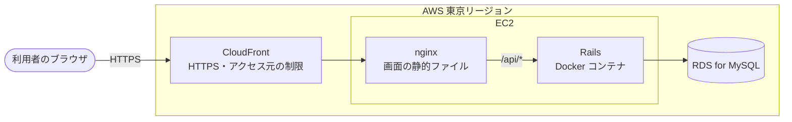

# 問い合わせ管理アプリ 技術スタック

## 1. 文書情報

| 項目 | 内容 |
| --- | --- |
| 文書名 | 問い合わせ管理アプリ 技術スタック |
| 版数 | 1.1 |
| 作成日 | 2026-10-31 |
| 最終更新日 | 2026-10-31 |
| 作成者 | KeiT0773 |
| ステータス | 作成中（レビュー待ち） |
| 上位文書 | [要件定義書](requirements.md) |
| 関連文書 | [機能要件書](functional-requirements.md)、[画面要件書](screen-requirements.md)、[データ要件書](data-requirements.md)、インフラ設計書（作成予定） |

本書は、要件定義書 2.4 で「基本設計で決定する」とした、各層で使用する技術（プログラミング言語、フレームワーク、データベース製品、周辺ツール）を定義する。

各技術の版数は、本書の作成時点（2026-10-31）で調べた最新の安定版の系列を記す。細かい版数（パッチ版）は、雛形を作成した時点で確定し、本書を更新する。

### 1.1 変更履歴

| 版数 | 日付 | 変更内容 | 変更者 |
| --- | --- | --- | --- |
| 1.0 | 2026-10-31 | 初版作成。タスク管理アプリから、フロントエンドを Next.js、バックエンドを Ruby on Rails、データベースを MySQL、サーバー構成を EC2 + RDS に変更 | KeiT0773 |
| 1.1 | 2026-10-31 | 8. 保留事項の 5 件を決定。Next.js は静的ファイルに書き出して EC2 上の nginx で配信、開発時の API 呼び出しは Rails 側で CORS を許可（rack-cors）、HTTPS は CloudFront を EC2 の前に置いて実現、アクセス元の制限は CloudFront Functions、EC2 上の Rails は Docker で動かす。これに合わせて 3.・4.・9. を更新 | KeiT0773 |

---

## 2. 選定方針

- フロントエンドは **Next.js**、バックエンドは **Ruby + Ruby on Rails**、データベースは **MySQL** を使用する（プロジェクト方針として指定）。
- サーバーは **Amazon EC2 + Amazon RDS** の構成とする（プロジェクト方針として指定）。
- 周辺ツールは、上記のフレームワーク・言語と組み合わせるうえで標準的で、学習資料が豊富なものを選ぶ。フレームワークの雛形に同梱されているものがあれば、それを優先して使う。
- 本プロジェクトは Web アプリケーション開発の学習も目的とする（要件定義書 2.1）ため、構成をなるべく単純に保ち、必要になるまでライブラリを追加しない。

### 2.1 タスク管理アプリとの違い

本プロジェクトは、先行プロジェクトのタスク管理アプリと同じ画面構造（カンバンボード）を持つが、各層の技術とサーバー構成を変える。同じ種類のアプリを別の技術で作ることで、技術ごとの違いを学ぶ。

| 層 | タスク管理アプリ | 本プロジェクト |
| --- | --- | --- |
| フロントエンド | React + Vite | Next.js（React を含む） |
| バックエンド | Java + Spring Boot | Ruby + Ruby on Rails（API モード） |
| データベース | PostgreSQL | MySQL |
| ローカルでのバックエンドの実行 | PC に JDK を入れて直接実行 | Docker で実行（6.） |
| サーバー構成 | CloudFront + S3 / ECS on Fargate / RDS | CloudFront + EC2 + RDS（9.） |

---

## 3. バックエンド

| 項目 | 選定 | 役割・選定理由 |
| --- | --- | --- |
| 言語 | Ruby 4.0 系 | プロジェクト方針として指定。2025-12 に公開された最新の系列で、作成時点の最新は 4.0.6 以降。Rails 8.1 が対応する。雛形作成時に Rails や gem の対応に問題があれば 3.4 系にとどめる |
| フレームワーク | Ruby on Rails 8.1 系（API モード） | Ruby の Web アプリケーション開発で最も標準的で、教材・記事が最も多い。作成時点の最新は 8.1.3 以降（セキュリティ更新は 2027-10 まで）。画面は Next.js が受け持つため、画面の生成に使う機能を省いた API モード（`rails new --api`）で作る |
| Web サーバー | Puma | Rails の雛形に同梱。HTTP の要求を受けて Rails に渡す |
| パッケージ管理 | Bundler（RubyGems） | Ruby に同梱。使う gem（ライブラリ）と版数を `Gemfile` / `Gemfile.lock` で管理する |
| REST API | Rails の Action Controller（API モード） | フロントエンドからの HTTP 要求を受け付け、JSON で応答する |
| CORS | rack-cors | 開発時は画面（http://localhost:3000）と API（http://localhost:3001）のポートが異なり、ブラウザが別のサイトとして扱うため、Rails 側で画面からの呼び出しを許可する（8. No.2）。API モードの雛形の `Gemfile` にコメントアウトされた状態で入っているものを有効にする。許可する送信元は設定で切り替え、開発時の `http://localhost:3000` だけとする。本番は CloudFront で画面と API を同じドメインにするため、送信元を許可する必要が無い（9.） |
| DB アクセス | Active Record | Ruby のクラスとテーブルを対応づけ、SQL を直接書かずに読み書きする。Rails の標準 |
| MySQL への接続 | mysql2 gem | `rails new -d mysql` で入る、Rails の標準の MySQL 接続ライブラリ |
| 入力チェック | Active Model の検証（validations） | 「件名・問い合わせ者・問い合わせ内容が空なら登録しない」（FR-01）などの検証をモデルに宣言する。Rails の標準 |
| DB マイグレーション | Rails のマイグレーション（Active Record Migrations） | テーブル定義の変更を Ruby のファイルとして履歴管理し、`bin/rails db:migrate` で DB へ反映する。Rails の標準のため追加の選定は不要 |
| コード検査 | RuboCop（rubocop-rails-omakase） | Rails 8 の雛形に同梱される、Rails チームが定めた規約による検査。`bin/rubocop` で実行する |
| セキュリティ検査 | Brakeman | Rails 8 の雛形に同梱。SQL インジェクションなどの典型的な脆弱性をコードから検出する |
| テスト | Minitest（Rails 同梱） | Rails の標準のテストの仕組み。追加の選定は不要。RSpec の方が資料は多いが、必要になるまで追加しない方針（2.）を優先する |

---

## 4. フロントエンド

| 項目 | 選定 | 役割・選定理由 |
| --- | --- | --- |
| フレームワーク | Next.js 16 系（App Router） | プロジェクト方針として指定。作成時点の最新は 16.4 系。Next.js の標準である App Router で作る。雛形は `create-next-app` で作成する |
| UI ライブラリ | React 19 系 | Next.js が使う UI ライブラリ。版数は Next.js の雛形に合わせる |
| 言語 | TypeScript | `create-next-app` の既定。API がやり取りするデータ（問い合わせ・リスト）の形を型として定義でき、バックエンドとの食い違いを早期に検出できる。版数は雛形に合わせる |
| 画面の作り方 | クライアントコンポーネントでボードを描画する | 画面は 1 ページ（ボード画面と、その手前に重ねる問い合わせ詳細）で、データはすべてバックエンドの API から取得する。ドラッグ&ドロップや入力をブラウザで扱うため、ボードはクライアントコンポーネント（`'use client'`）として作る |
| 本番用のビルド | 静的ファイルに書き出す（`output: 'export'`） | `npm run build` で HTML・JavaScript・CSS を書き出し、EC2 上の nginx で配信する（8. No.1）。Next.js のサーバーを本番で動かさないため、サーバーでだけ動く機能（サーバーでのデータ取得、API ルート、`rewrites` など）は使わない |
| バックエンドへの接続 | API の URL を環境変数で切り替える | 開発時は `http://localhost:3001`（Rails。CORS で許可。3.）、本番は画面と同じドメインの `/api`（CloudFront 経由。9.）を呼ぶ。環境変数の名前と既定値はフロントエンド設計書で定める |
| ドラッグ&ドロップ | @hello-pangea/dnd 18 系 | タスク管理アプリと同じ。列の間で問い合わせを動かす用途に特化しており、React 19 に対応している（FR-04, FR-05） |
| サーバー通信 | fetch API（ブラウザ標準） | 想定データ量（問い合わせ 300 件程度）・利用者数名の規模では追加ライブラリを必要としない |
| スタイル | CSS（CSS Modules、Next.js 同梱） | 画面モック（`mock/style.css`）をほぼそのまま流用できる。CSS Modules は Next.js が標準で処理するため追加パッケージは不要。UI ライブラリや Tailwind CSS は使わない |
| コード検査・整形 | `create-next-app` に同梱のコード検査 + Prettier | コード検査は雛形の構成に従う（ESLint など。雛形作成時に確定する）。整形は Prettier を追加する。改行コードはリポジトリ直下の `.gitattributes` と `.editorconfig` で LF に統一する |
| テスト | Vitest + React Testing Library | Next.js の公式ドキュメントで手順が示されている組み合わせ。DOM の再現には jsdom を使う |
| パッケージ管理 | npm 11 | Node.js に同梱。追加インストール不要 |

---

## 5. データベース

| 項目 | 選定 | 役割・選定理由 |
| --- | --- | --- |
| 製品 | MySQL 8.4 系（LTS） | プロジェクト方針として指定。8.4 は長期サポート版で、サポートは 2032-04 まで。新しい LTS の 9.7 系も公開されているが、本番で使う Amazon RDS では 9.7 がプレビュー環境でしか使えない（2026-10 時点）ため、RDS で正式に使える 8.4 系を選ぶ。ローカルと本番で同じ系列にそろえる |
| 文字コード | utf8mb4 | MySQL 8.4 の既定。日本語と絵文字を含むすべての文字を保存できる |
| ローカルでの起動 | Docker Desktop + Docker Compose | PC に MySQL を直接インストールせず、コマンド一つで起動・破棄できる。公式イメージ `mysql:8.4` を使う |

---

## 6. 開発環境

| 項目 | 選定 | 備考 |
| --- | --- | --- |
| OS | Windows 11 | 要件定義書 5.1 の想定端末と同じ |
| エディタ | Cursor | Ruby・Next.js 用の拡張機能を追加する |
| 必要なインストール | Docker Desktop、Node.js 24（LTS） | どちらも導入済み（Docker 29.8、Node.js v24.20.0）。Ruby は PC に入れない |
| バックエンド・DB の実行 | Docker Compose | バックエンド（Rails）と MySQL をコンテナで動かす。Windows に Ruby を直接入れると、MySQL への接続ライブラリなどのビルドでつまずきやすいため避ける。本番（Linux の EC2）と同じ Linux 上で動くことも利点。Rails のコマンドは `docker compose exec backend bin/rails ...` のようにコンテナの中で実行する |
| フロントエンドの実行 | PC の Node.js で直接実行 | `npm run dev` で起動する。ファイルの変更をすぐ画面に反映させるため、コンテナには入れない |
| バージョン管理 | Git + GitHub | 既存のリポジトリを継続して使用する |

### 6.1 開発時のポート

| サーバー | ポート | 根拠 |
| --- | --- | --- |
| フロントエンド（Next.js） | 3000 | Next.js の既定。ブラウザではこの URL（http://localhost:3000）を開く |
| バックエンド（Rails） | 3001 | Rails の既定は 3000 だが、Next.js と重なるため 3001 にする。Next.js と Rails を組み合わせるときによく使われる割り当て |
| MySQL（Docker） | 3306 | MySQL の既定 |

ポートが使用中でも別のポートへ逃げない、という規則（CLAUDE.md）は引き続き適用する。CLAUDE.md・フック・スキルの書き換えは別の Issue で行う。

---

## 7. リポジトリ構成

1つのリポジトリにドキュメント・バックエンド・フロントエンドをまとめて管理する。

```
InquiryManagement/
├── docs/          要件定義書・設計書
├── mock/          画面モック（要件確認用）
├── backend/       Ruby on Rails アプリケーション（API モード）
├── frontend/      Next.js アプリケーション
├── infra/         AWS の構成（Terraform）とデプロイ用スクリプト
└── compose.yaml   ローカル開発用（Rails と MySQL）
```

---

## 8. 決定を保留する事項

現時点で保留している事項は無い。1.0 版で保留していた次の 5 件は、1.1 版で決定した。構成の詳細はインフラ設計書（作成予定）・フロントエンド設計書（作成予定）で定める。

| No | 事項 | 決定 | 理由 |
| --- | --- | --- | --- |
| 1 | Next.js の本番での配信の形 | 静的ファイルに書き出し（`output: 'export'`）、EC2 上の nginx で配信する | 画面は 1 ページで、データはすべて API から取るため、Next.js のサーバーを動かす必要が無い。EC2 で動かすプロセスが減り、運用が単純になる |
| 2 | 開発時のフロントエンドからバックエンドへの接続方式 | Rails 側で CORS を許可する（rack-cors。3.） | No.1 で静的ファイルに書き出すため、Next.js の `rewrites`（転送）は本番で使えない。開発時だけ転送で動くと本番との違いが生まれるため、画面から API を直接呼ぶ形にそろえる |
| 3 | HTTPS の実現方法 | CloudFront を EC2 の前に置く | 独自ドメインを取得しない（要件定義書 8.）ため、CloudFront に付く `*.cloudfront.net` のドメインと証明書を使う。タスク管理アプリと同じ方法 |
| 4 | アクセス元の制限の方式 | CloudFront Functions | No.3 で CloudFront を置くため、タスク管理アプリと同じ方法（自宅の IPv6 のネットワーク以外を 403 にする）をそのまま使える |
| 5 | EC2 上での Rails の動かし方 | Docker で動かす | ローカル（6.）と同じ Docker イメージを本番でも使い、環境の違いによる不具合を防ぐ。EC2 に Ruby を入れずに済む |

---

## 9. 本番環境

[要件定義書](requirements.md) 決定事項 No.8 で「基本設計で決める」とした配置先。構成の詳細と選定理由はインフラ設計書（作成予定）に記載する。ここでは使うサービスと、その選定理由を記す。



- 画面と API は同じ CloudFront のドメインで提供する。nginx が画面の静的ファイルを返し、`/api/*` で始まる要求だけを Rails へ転送する。画面と API が同じドメインになるため、本番では CORS の許可は不要（3.）。
- CloudFront と EC2 の間の通信の守り方（EC2 を直接インターネットから呼べないようにする方法など）は、インフラ設計書で定める。

| 項目 | 選定 | 役割・選定理由 |
| --- | --- | --- |
| クラウド | AWS（東京リージョン `ap-northeast-1`） | タスク管理アプリと同じ。利用者が日本にいる。既存の AWS アカウントと AWS CLI の設定がある |
| HTTPS・配信の入口 | Amazon CloudFront | 利用者からの要求をすべて受け、HTTPS で通信する（8. No.3）。独自ドメインを取得せず、`*.cloudfront.net` のドメインと証明書を使う |
| アクセス元の制限 | Amazon CloudFront Functions | 要求ごとに CloudFront で動く短い JavaScript で、アクセス元の IP アドレスが自宅のネットワーク以外なら 403 を返す（要件定義書 7.「アクセス制御」、8. No.4）。タスク管理アプリと同じ方法で、月 200 万回まで無料 |
| アプリケーションの実行 | Amazon EC2（1 台） | プロジェクト方針として指定。フロントエンド（Next.js）とバックエンド（Rails）を同じサーバーで動かす。タスク管理アプリのサーバーレス構成（S3・Fargate）と違い、OS の管理（更新・プロセスの管理）を自分で行う構成を学ぶ。インスタンスの種類は、無料利用枠の対象と同じ規模（`t4g.micro` / `t3.micro` など）を上限とする（要件定義書 7.「費用」） |
| データベース | Amazon RDS for MySQL 8.4 系（`db.t4g.micro`） | ローカル（5.）と同じ MySQL 8.4 系。インストール・パッチ・バックアップを AWS に任せる。タスク管理アプリと同じく、無料利用枠の対象と同じ規模を上限とする |
| Web サーバー | nginx | EC2 上で、Next.js が書き出した画面の静的ファイルを返し、`/api/*` を Rails へ転送する（8. No.1）。nginx を Docker で動かすか EC2 に直接入れるかはインフラ設計書で定める |
| Rails の実行 | Docker（EC2 上） | ローカルと同じ Docker イメージで Rails（Puma）を動かす（8. No.5）。イメージの作り方・置き場所（EC2 上で作るか、Amazon ECR に置くか）と、プロセスの起動・再起動の管理はインフラ設計書で定める |
| IaC | Terraform | タスク管理アプリと同じ。すべての AWS リソースをコードで定義する。版数はインフラ設計書の作成時に確定する |
| CLI | AWS CLI v2 | タスク管理アプリと同じ。認証の確認や、Terraform の外側の操作を行う |
